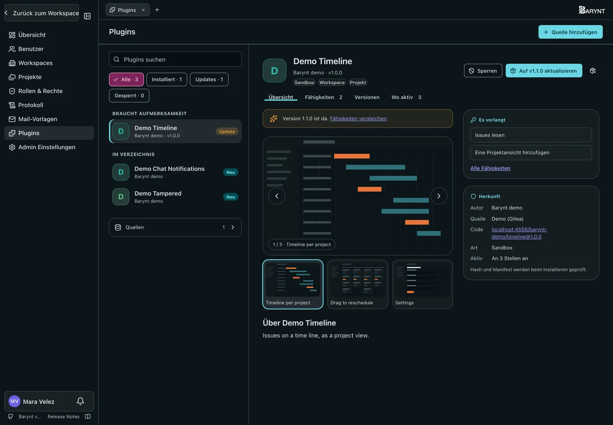
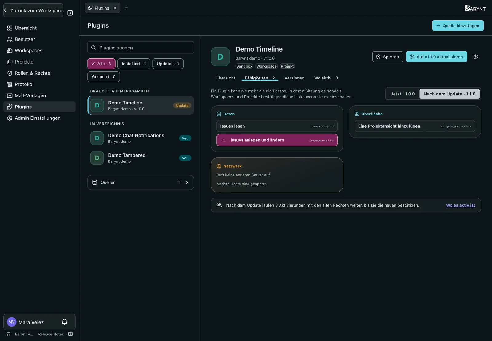

Plugins erweitern Barynt: eine Projektansicht, ein Dashboard-Widget, ein Abgleich mit einem anderen Werkzeug. Sie kommen aus einem **Verzeichnis**, einer Liste von Plugins mit der Adresse ihres Codes. Zwei Schritte halten es in deiner Hand:

1. Ein **Plattform-Admin** installiert ein Plugin auf dem Server. Damit ist noch nichts eingeschaltet.
2. Ein **Workspace- oder Projekt-Admin** schaltet es dort ein, wo er es haben will, nachdem er bestätigt hat, was es dort darf.

> [!NOTE]
> Ein Plugin kann nie mehr als die Person, die es nutzt. Was es verlangt (seine _Fähigkeiten_, etwa „Issues lesen“), wird angezeigt, bevor jemand es installiert oder einschaltet, und es kann nichts nutzen, was nicht bestätigt wurde.

## Installieren (Plattform-Admins)

Öffne **Admin → Plugins**. Links stehen alle Plugins: was **Aufmerksamkeit braucht** (ein Update, ein gesperrtes Plugin), was **installiert** ist und was deine Quellen **im Verzeichnis** anbieten, mit Suche und Filtern. Rechts steht das Plugin, das du gewählt hast.

Ist kein Plugin gewählt, zeigt die rechte Seite die Startseite des Stores: wie viele Plugins installiert und eingeschaltet sind, wartende Updates, was das Verzeichnis anbietet und ob jede Quelle lesbar ist. Darunter stehen die Plugins, die das Verzeichnis **vorstellt**, was **neu im Verzeichnis** ist und **alle Plugins** nach Kategorie.

1. **Quelle hinzufügen:** die Git-Adresse eines Repositorys mit einer `plugins.json` im Hauptverzeichnis, auf GitHub, GitLab, Gitea/Forgejo oder Bitbucket, auch auf selbst gehosteten Servern. Barynt erkennt den Anbieter an der Adresse; wenn nicht, wähl ihn aus. Optional gibst du einen Branch oder Tag an. Bei einem einfachen Webserver trägst du die Adresse der `plugins.json` selbst ein und wählst **Webserver (HTTPS)**. **Verbindung prüfen** liest das Verzeichnis, bevor du speicherst.

   Für ein privates Repository gib Zugangsdaten an (ein Access Token, oder `Benutzer:Passwort` für Bitbucket-App-Passwörter und Webserver). Sie werden verschlüsselt gespeichert und nur an den Server dieser Quelle geschickt, nie an Plugins, die woanders liegen.

   > [!NOTE]
   > Ein Git-Server in eurem internen Netz ist gesperrt, solange er nicht in `PLUGIN_INTERNAL_HOSTS` steht.
2. Wähl ein Plugin unter **Im Verzeichnis**. Seine Seite zeigt die Screenshots, was es verlangt und woher der Code kommt. Wähl eine Version, wenn du nicht die neueste willst.
3. Klicke auf **Installieren**. Barynt lädt diese Version und prüft sie: Die Dateien müssen zu dem passen, was das Verzeichnis angibt, und die Version muss auf deinem Barynt laufen. Passt etwas nicht, wird es nicht installiert.
4. Der Dialog zeigt die Screenshots des Plugins, falls es welche hat, dann Autor, Herkunft des Codes, Art, wo es nutzbar ist, was es verlangt und welche anderen Server es aufrufen darf. Setz den Haken und installiere.

| Aktion | Was sie tut |
| --- | --- |
| **Aktualisieren** | Ein Plugin mit neuerer Version steht unter **Braucht Aufmerksamkeit** und zeigt **Auf … aktualisieren**. Workspaces und Projekte nutzen es weiter. Verlangt das Update mehr als vorher, müssen sie erneut bestätigen; bis dahin tut es nur, was bestätigt war. |
| **Zurück zu v…** | Geht zur vorigen Version zurück. Die neuere bleibt installiert. |
| **Sperren** | Stoppt das Plugin sofort überall. Aktivierungen und Daten bleiben und gelten wieder, sobald du es entsperrst. |
| **Deinstallieren** | Entfernt alle Versionen. Du wählst, ob seine Daten in Workspaces und Projekten mit gelöscht werden oder ausgeschaltet erhalten bleiben. |

Die Seite eines Plugins hat vier Tabs:

- **Übersicht:** Screenshots, Beschreibung, was es verlangt und woher es kommt.
- **Fähigkeiten:** alles, was es darf, nach Daten, Oberfläche und Ereignissen, und welche anderen Server es aufruft. Wartet ein Update, schaltest du zwischen **Jetzt** und **Nach dem Update** um und siehst vorher, was dazukommt (+) und was wegfällt (−).
- **Versionen:** verfügbare, aktive und frühere Versionen mit ihren Release Notes, falls das Verzeichnis welche hat, und **Aktualisieren**, **Zurück zu v…** und älteren Releases zum Installieren.
- **Wo aktiv:** jeder Workspace, der es eingeschaltet oder für Projekte freigegeben hat, und seine Projekte.

**Quellen** unten in der Liste zeigt jede Quelle mit Anbieter, wann sie zuletzt gelesen wurde und ob es einen Fehler gab. Ein Verzeichnis wird höchstens alle paar Minuten gelesen; **Jetzt abrufen** liest es sofort neu.

Jeder Schritt steht im [Protokoll](audit.md).

## Einschalten (Workspace-Manager und Projekt-Admins)

Zwei Schritte: Der Workspace schaltet ein Plugin frei, dann schaltet jedes Projekt es in seinen eigenen Einstellungen ein.

### Freischalten im Plugin Store

Öffne die **Einstellungen** und wähle im Umschalter oben **Plugin Store**, neben Persönlich, Projekt und Workspace. Ihn sehen nur die Manager des Workspaces – wer im Workspace die Berechtigung _Switch installed plugins on and off and configure them_ hat (Owner, Admins und Manager) – und erst, wenn auf dem Server ein Plugin installiert ist. Plattform-Admins sehen ihn schon vorher, mit einer Startseite, die erklärt, wie Plugins installiert werden.

Der Store zeigt alle Plugins, die deine Plattform-Admins installiert haben, mit Suche, Kategorien, Screenshots und dem, was sie dürfen. Bist du in mehreren Workspaces, wählst du oben in der Liste einen aus – wie in den Workspace-Einstellungen. Öffne ein Plugin; eine Zeile unter dem Namen zeigt, ob es in diesem Workspace freigeschaltet ist und in welchen Projekten es an ist.

**Freischalten** zeigt, was das Plugin darf; bestätigst du es, ist es freigeschaltet. Ein Plugin für Workspaces läuft dann im Workspace, ein Plugin für Projekte erscheint in den Einstellungen jedes Projekts. Nach einem Update, das mehr verlangt, bietet die Zeile unter dem Namen **Erneut bestätigen** an.

**Freischaltung aufheben** schaltet das Plugin im Workspace und in allen seinen Projekten aus, und es verschwindet aus den Projekteinstellungen. Einstellungen und Daten bleiben.

### Einschalten in einem Projekt

Ein freigeschaltetes Plugin für Projekte hat in den Einstellungen jedes Projekts einen Eintrag unter **Plugins**, unterhalb der anderen Bereiche. Projekt-Admins öffnen ihn, prüfen, was es im Projekt darf, und klicken **Einschalten**. Läuft es, enthält die Seite das Formular, das das Plugin mitbringt (ein Kanalname, wem zugewiesen wird, Labels, Wochentage, …), und unten das Ausschalten – Einstellungen und Daten bleiben, bis du **Daten löschen** wählst.

### Wo Plugins erscheinen

Ein Plugin mit eigenen Ansichten oder Seiten zeigt sie in der Seitenleiste, jeweils mit dem Zeichen des Plugins:

- **Im Projekt eingeschaltet**: unter dem Projekt, neben Dashboard, Board und Aufgaben; Seiten unter der Überschrift **Plugins**.
- **Im Workspace eingeschaltet**: Ansichten oben in der Seitenleiste, neben Dashboard und Board des Workspaces (auf dem Handy im Abschnitt **Plugins**); Seiten in einem eigenen Abschnitt **Plugins**.

Die Seite eines Plugins nennt unter dem Titel immer den Namen des Plugins.

Ein Plugin kann auch **Dashboard-Widgets** mitbringen: Auf einem Dashboard stehen sie unter **Widget hinzufügen** im Bereich **Plugins**, mit Live-Vorschau. Manche sind Vorlagen aus Barynts eigenen Bausteinen: Einmal hinzugefügt, ist so ein Widget ein eigenes Widget des Dashboards – es bleibt, wenn das Plugin ausgeschaltet wird, und mit **Anpassen** änderst du es vor dem Hinzufügen. Und manche Plugins zeichnen ihre **Einstellungsseite** selbst – die Seite unter **Plugins** in den Einstellungen zeigt dann das Formular des Plugins; was es speichert, prüft Barynt wie jede andere Einstellung. Andere ergänzen unter Barynts Formular einen eigenen Teil – etwa eine Verbindungsprüfung.

Plugins können auch **Bausteine** für eigene Widgets mitbringen: Im Widget-Builder listet **Baustein hinzufügen** sie neben Barynts eigenen, jeweils mit ihren Einstellungen. Ist das Plugin ausgeschaltet, sagt der Baustein das – der Rest des Widgets bleibt.

Manche Plugins zeigen ein **Panel in jedem Issue** eines Projekts, in dem sie eingeschaltet sind – unter den Anhängen, mit dem Namen des Plugins. Ein Panel, das du nicht brauchst, klappst du zu; es bleibt für dich zugeklappt. Andere setzen **Badges** auf die Karten im Board und die Zeilen der Liste – eine Fälligkeit, ein offener Merge Request. **Anzeige** listet sie unter *Plugin-Badges*; was du nicht brauchst, schaltest du dort aus. Manche zeigen eine ganze Zeile auf der Karte – etwa einen Merge Request mit Status und Pipeline.

### Einstellungen eines Plugins im Workspace

Ein Plugin, das im Workspace läuft und Einstellungen hat, bekommt in den Workspace-Einstellungen einen Eintrag unter **Plugins** mit seinem Formular.

### Zugangsdaten

Ein Plugin, das mit einem anderen Dienst spricht – einem Git-Server, einem Chat –, braucht dafür vielleicht ein Zugangstoken. Je nach Plugin hinterlegst du es an einer von drei Stellen:

- **Für den ganzen Workspace**: in den Workspace-Einstellungen, auf der Seite des Plugins unter **Plugins** (Workspace-Manager).
- **Je Projekt**: in den Projekt-Einstellungen, auf der Seite des Plugins (Projekt-Admins).
- **Dein eigenes**: in deinen persönlichen Einstellungen unter **Plugins**, wenn das Plugin mit dem Konto jeder Person arbeitet.

Barynt speichert den Wert verschlüsselt und hängt ihn selbst an die Anfragen des Plugins an diesen Dienst – das Plugin sieht ihn nie, und nach dem Speichern sieht ihn auch sonst niemand mehr: Die Seite zeigt nur, ob einer hinterlegt ist und seit wann. **Entfernen** nimmt ihn zurück; die Anfragen des Plugins an den Dienst schlagen dann fehl, bis jemand einen neuen hinterlegt. Hinterlegen und Entfernen für einen Workspace oder ein Projekt landen im Protokoll (welche Angabe, nie der Wert).

## Installieren (Plattform-Admins)

Öffne **Admin → Plugins**. Links stehen alle Plugins: was **Aufmerksamkeit braucht** (ein Update, ein gesperrtes Plugin), was **installiert** ist und was deine Quellen **im Verzeichnis** anbieten, mit Suche und Filtern. Rechts steht das Plugin, das du gewählt hast.

Ist kein Plugin gewählt, zeigt die rechte Seite die Startseite des Stores: wie viele Plugins installiert und eingeschaltet sind, wartende Updates, was das Verzeichnis anbietet und ob jede Quelle lesbar ist. Darunter stehen die Plugins, die das Verzeichnis **vorstellt**, was **neu im Verzeichnis** ist und **alle Plugins** nach Kategorie.

1. **Quelle hinzufügen:** die Git-Adresse eines Repositorys mit einer `plugins.json` im Hauptverzeichnis, auf GitHub, GitLab, Gitea/Forgejo oder Bitbucket, auch auf selbst gehosteten Servern. Barynt erkennt den Anbieter an der Adresse; wenn nicht, wähl ihn aus. Optional gibst du einen Branch oder Tag an. Bei einem einfachen Webserver trägst du die Adresse der `plugins.json` selbst ein und wählst **Webserver (HTTPS)**. **Verbindung prüfen** liest das Verzeichnis, bevor du speicherst.

   Für ein privates Repository gib Zugangsdaten an (ein Access Token, oder `Benutzer:Passwort` für Bitbucket-App-Passwörter und Webserver). Sie werden verschlüsselt gespeichert und nur an den Server dieser Quelle geschickt, nie an Plugins, die woanders liegen.

   > [!NOTE]
   > Ein Git-Server in eurem internen Netz ist gesperrt, solange er nicht in `PLUGIN_INTERNAL_HOSTS` steht.
2. Wähl ein Plugin unter **Im Verzeichnis**. Seine Seite zeigt die Screenshots, was es verlangt und woher der Code kommt. Wähl eine Version, wenn du nicht die neueste willst.
3. Klicke auf **Installieren**. Barynt lädt diese Version und prüft sie: Die Dateien müssen zu dem passen, was das Verzeichnis angibt, und die Version muss auf deinem Barynt laufen. Passt etwas nicht, wird es nicht installiert.
4. Der Dialog zeigt die Screenshots des Plugins, falls es welche hat, dann Autor, Herkunft des Codes, Art, wo es nutzbar ist, was es verlangt und welche anderen Server es aufrufen darf. Setz den Haken und installiere.

| Aktion | Was sie tut |
| --- | --- |
| **Aktualisieren** | Ein Plugin mit neuerer Version steht unter **Braucht Aufmerksamkeit** und zeigt **Auf … aktualisieren**. Workspaces und Projekte nutzen es weiter. Verlangt das Update mehr als vorher, müssen sie erneut bestätigen; bis dahin tut es nur, was bestätigt war. |
| **Zurück zu v…** | Geht zur vorigen Version zurück. Die neuere bleibt installiert. |
| **Sperren** | Stoppt das Plugin sofort überall. Aktivierungen und Daten bleiben und gelten wieder, sobald du es entsperrst. |
| **Deinstallieren** | Entfernt alle Versionen. Du wählst, ob seine Daten in Workspaces und Projekten mit gelöscht werden oder ausgeschaltet erhalten bleiben. |

Die Seite eines Plugins hat vier Tabs:

- **Übersicht:** Screenshots, Beschreibung, was es verlangt und woher es kommt.
- **Fähigkeiten:** alles, was es darf, nach Daten, Oberfläche und Ereignissen, und welche anderen Server es aufruft. Wartet ein Update, schaltest du zwischen **Jetzt** und **Nach dem Update** um und siehst vorher, was dazukommt (+) und was wegfällt (−).
- **Versionen:** verfügbare, aktive und frühere Versionen mit ihren Release Notes, falls das Verzeichnis welche hat, und **Aktualisieren**, **Zurück zu v…** und älteren Releases zum Installieren.
- **Wo aktiv:** jeder Workspace, der es eingeschaltet oder für Projekte freigegeben hat, und seine Projekte.

**Quellen** unten in der Liste zeigt jede Quelle mit Anbieter, wann sie zuletzt gelesen wurde und ob es einen Fehler gab. Ein Verzeichnis wird höchstens alle paar Minuten gelesen; **Jetzt abrufen** liest es sofort neu.

Jeder Schritt steht im [Protokoll](audit.md).

## Einschalten (Workspace- und Projekt-Admins)

Öffne die **Einstellungen** und wähle im Umschalter oben **Plugin Store**, neben Persönlich, Projekt und Workspace. Du siehst ihn, wenn du im Workspace oder in einem seiner Projekte die Berechtigung _Switch installed plugins on and off and configure them_ hast; Owner, Admins, Manager und Projekt-Admins haben sie.

Der Store zeigt alle Plugins, die deine Plattform-Admins installiert haben, mit Suche, Kategorien, Screenshots und dem, was sie dürfen. Bist du in mehreren Workspaces, wählst du oben in der Liste einen aus – wie in den Workspace-Einstellungen. Öffne ein Plugin; eine Zeile unter dem Namen zeigt, ob es in diesem Workspace freigeschaltet ist und in welchen Projekten es an ist.

**Hinzufügen** und **Bearbeiten** öffnen ein Fenster mit zwei Schritten:

1. **Freischalten:** Ein Workspace-Admin schaltet das Plugin für den Workspace frei. Dann läuft es im Workspace (wenn es dort etwas tut), und Projekte dürfen es einschalten.
2. **In Projekten aktivieren:** Hake jedes Projekt an, das du verwaltest und in dem es laufen soll. Solange es nicht freigeschaltet ist, ist dieser Schritt gesperrt. Abgewählte Projekte werden ausgeschaltet; Einstellungen und Daten bleiben, der Papierkorb daneben löscht sie.

Wo es neu läuft, bestätigst du einmal, was es darf. Nach einem Update, das mehr verlangt, warten diese Stellen auf eine Bestätigung, und das Fenster bietet sie an.
Nimmst du die Freischaltung zurück, wird das Plugin im Workspace und in allen seinen Projekten ausgeschaltet; ihre Daten bleiben.

### Einstellungen eines Plugins

Ein eingeschaltetes Plugin mit Einstellungen bekommt in den Einstellungen des Workspaces oder Projekts einen Eintrag unter **Plugins**, unterhalb der anderen Bereiche. Seine Seite enthält das Formular, das das Plugin mitbringt (ein Kanalname, was gepostet wird, …), und unten das Ausschalten an dieser Stelle.

## Eigene Plugins bauen

Wie man selbst ein Plugin schreibt, steht unter [Building plugins](../../../dev/plugins.md) in der Entwickler-Doku (auf Englisch).
