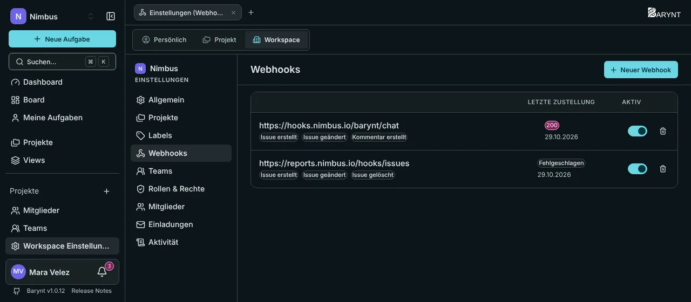
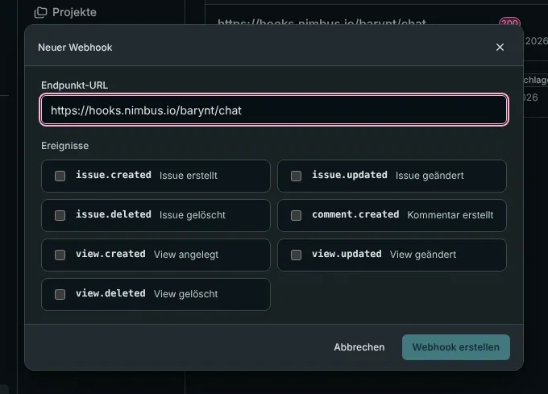

Bei einem **Webhook** ruft Barynt **dich** an. Sobald im Workspace etwas passiert, das dich interessiert, schickt es eine Nachricht an eine Adresse, die du festlegst. So postest du neue Bugs in einen Chat-Kanal, startest einen Build, wenn ein Issue auf _In Review_ rückt, oder hältst ein anderes System aktuell, ohne ständig nachzufragen.



## Was Teams damit machen

- **Chat-Benachrichtigungen:** eine Nachricht im Team-Kanal bei jedem neuen _Dringend_-Bug.
- **Automatisierung:** Wird ein Issue mit dem Label `Kunde` angelegt, öffnet sich ein Ticket im Support-System.
- **Berichte:** jede Änderung in ein Data Warehouse kopieren.
- **Abgleich** einer Tabelle, einer Statusseite oder eines Kundenportals.

Für manches braucht es einen Entwickler oder ein Werkzeug wie Zapier, Make oder n8n, das einen Webhook empfangen kann. Die Einstellungsseite selbst braucht keinen Code.

## Einen einrichten

Öffne **Workspace-Einstellungen → Webhooks** (du brauchst das Recht, Webhooks zu verwalten, das Owner, Admins und Manager haben) und klicke auf **Neuer Webhook**.



1. **Endpunkt-URL:** die Adresse, die die Nachrichten bekommen soll, zum Beispiel `https://example.com/webhooks/barynt`. Sie muss mit `https://` oder `http://` beginnen. Nimm HTTPS, denn die Nachrichten enthalten den Inhalt deiner Issues.
2. **Ereignisse:** Wähle, worüber du Bescheid wissen willst, mindestens eines. Sie sind gruppiert (Issues, Kommentare, Labels, Projekte, Mitglieder, Ansichten); der Schalter neben einer Gruppe wählt sie ganz.
3. Klicke auf **Webhook erstellen**. Barynt zeigt das **Secret** einmal an: Kopiere es jetzt. Der Empfänger braucht es, um zu prüfen, dass eine Nachricht wirklich von deinem Barynt kommt.

Die Liste zeigt jeden Webhook mit den Ereignissen, auf die er hört, seiner **letzten Zustellung** (der HTTP-Status oder der Fehler) und einem Schalter, um ihn **ein- oder auszuschalten**. Ein Webhook, an den noch nie etwas zugestellt wurde, sagt das („Noch nie zugestellt“). **Löschen** stoppt ihn sofort.

Adresse und Ereignisse eines Webhooks lassen sich nachträglich nicht ändern. Lege dafür einen neuen an und lösche den alten. Dasselbe gilt für ein **neues Secret**, etwa nachdem es durchgesickert ist: Webhook löschen und neu anlegen.

Webhooks gehören zu **einem Workspace** und melden nur Ereignisse dieses Workspace. Jede Änderung zählt, egal wer sie wo macht: in der App, über die [REST-API](api.md), durch einen KI-Assistenten über [MCP](mcp.md) oder durch ein Plugin.

## Ereignisse

| Ereignis | Wann |
| --- | --- |
| `issue.created` | Ein Issue wird angelegt. |
| `issue.updated` | Irgendetwas an einem Issue ändert sich, auch ein Ziehen in eine andere Spalte auf dem Board. Die Nachricht enthält das **ganze aktuelle Issue** und in `changes`, was sich wovon worauf geändert hat. |
| `issue.status_changed` | Der Status ändert sich. Kommt zusätzlich zu `issue.updated`, für Empfänger, die nur das interessiert. |
| `issue.assigned` | Jemand anderes oder niemand ist zugewiesen. Ebenfalls zusätzlich zu `issue.updated`. |
| `issue.fields_changed` | Ein eigenes Feld ändert sich. Ebenfalls zusätzlich zu `issue.updated`. |
| `issue.deleted` | Ein Issue wird gelöscht. Die Nachricht ist eine kurze Momentaufnahme (ID, Kennung, Projekt, Titel). |
| `comment.created`, `comment.updated`, `comment.deleted` | Ein Kommentar wird geschrieben (auch eine Antwort), bearbeitet oder gelöscht. |
| `label.created`, `label.updated`, `label.deleted` | Ein Label des Workspace oder eines Projekts wird angelegt, umbenannt oder umgefärbt oder gelöscht. |
| `project.created`, `project.updated`, `project.archived`, `project.unarchived`, `project.deleted` | Ein Projekt wird angelegt, geändert (Name, Kürzel, Farbe, Sichtbarkeit), archiviert, wiederhergestellt oder gelöscht. |
| `member.added`, `member.removed`, `member.role_changed` | Jemand tritt dem Workspace oder einem Projekt bei, verlässt ihn oder bekommt eine andere Rolle. Eine Einladung zählt, sobald sie angenommen ist. Die Nachricht enthält keine E-Mail-Adresse. |
| `view.created`, `view.updated`, `view.deleted` | Eine **geteilte** View ändert sich. Private Views lösen nie etwas aus. |

Jedes Ereignis mit einer vollständigen Beispiel-Nachricht steht auf der Seite [Webhook-Ereignisse](../api-reference/webhook-events.md).

## Wie eine Nachricht aussieht

Barynt sendet einen HTTP-`POST` mit diesen Headern und einem JSON-Body:

| Header | Inhalt |
| --- | --- |
| `Content-Type` | `application/json` |
| `X-Barynt-Event` | Das Ereignis, wie `event` im Body. |
| `X-Barynt-Timestamp` | Wann die Nachricht gesendet wurde, in Millisekunden seit 1970. |
| `X-Barynt-Signature` | Die Signatur der Nachricht, mit deinem Secret erzeugt. |

```json
{
  "event": "issue.updated",
  "timestamp": 1772870400000,
  "workspaceId": "ws_1a2b3c",
  "projectId": "proj_9f8e7d",
  "actor": { "id": "u_1a2b3c", "name": "Alex Kim" },
  "via": null,
  "data": {
    "id": "i_4k2n1x",
    "ref": "WEB-42",
    "title": "Checkout kaputt",
    "status": "done",
    "statusCategory": "completed",
    "assignee": { "id": "u_7h3j2k", "name": "Priya Shah" },
    "project": { "id": "proj_9f8e7d", "name": "Website Relaunch" }
  },
  "changes": {
    "status": { "from": "in-progress", "to": "done" },
    "statusCategory": { "from": "started", "to": "completed" }
  }
}
```

- `event` sagt, was passiert ist, und `timestamp`, wann.
- `workspaceId` und `projectId` sagen, wo. `projectId` ist `null` bei etwas, das dem ganzen Workspace gehört, etwa einem Workspace-Label oder -Mitglied.
- `actor` ist, wer es getan hat (`null`, wenn niemand, zum Beispiel bei jemandem, der über die E-Mail-Domain der Firma beigetreten ist). `via` nennt das Plugin, wenn die Änderung über eines kam.
- `data` enthält das Issue, den Kommentar, das Label, das Projekt, das Mitglied oder die View in derselben Form wie in der [REST-API](../api-reference/issues.md).
- `changes` kommt nur bei einer Änderung: jedes Feld mit altem und neuem Wert. Ein eigenes Feld steht als `customFields.<key>` darin.

## Prüfen, dass eine Nachricht echt ist

Jeder, der die Empfangsadresse kennt, könnte falsche Nachrichten dorthin schicken. Darum ist jede Zustellung **signiert**. Der Empfänger berechnet dieselbe Signatur und vergleicht:

```text
signatur = hex( HMAC-SHA256( secret, timestamp + "." + rawBody ) )
```

Nimm den **Body genau so, wie er ankam**, vor jedem JSON-Parsen, und den Header `X-Barynt-Timestamp`. Die Signatur ist hexadezimal kodiert, ohne Präfix. In Node.js:

```js
import { createHmac, timingSafeEqual } from "node:crypto";

function isGenuine(secret, timestamp, rawBody, signature) {
  const expected = createHmac("sha256", secret)
    .update(`${timestamp}.${rawBody}`) // Timestamp, ein Punkt, der rohe Body
    .digest("hex");
  const a = Buffer.from(expected);
  const b = Buffer.from(signature);
  return a.length === b.length && timingSafeEqual(a, b);
}
```

In Python:

```python
import hmac, hashlib

def is_genuine(secret: str, timestamp: str, raw_body: bytes, signature: str) -> bool:
    expected = hmac.new(secret.encode(), f"{timestamp}.".encode() + raw_body, hashlib.sha256).hexdigest()
    return hmac.compare_digest(expected, signature)
```

Weise außerdem Nachrichten ab, deren Timestamp älter ist als ein paar Minuten (sagen wir fünf). Das verhindert, dass jemand eine alte Nachricht erneut abspielt: Weil der Timestamp mitsigniert ist, kann er ihn nicht einfach ändern.

Ein kompletter kleiner Empfänger mit Express:

```js
import express from "express";

const app = express();
app.post("/webhooks/barynt", express.raw({ type: "application/json" }), (req, res) => {
  const timestamp = req.get("X-Barynt-Timestamp");
  const signature = req.get("X-Barynt-Signature");
  const fresh = Math.abs(Date.now() - Number(timestamp)) < 5 * 60 * 1000;
  if (!fresh || !isGenuine(process.env.BARYNT_WEBHOOK_SECRET, timestamp, req.body.toString(), signature)) {
    return res.sendStatus(401);
  }
  const { event, data } = JSON.parse(req.body);
  console.log(event, data.ref ?? data.id);
  res.sendStatus(204); // schnell antworten, Langsames danach erledigen
});
app.listen(3000);
```

## Zustellung: was du erwarten kannst

- **Antworte innerhalb von zehn Sekunden mit einem `2xx`.** Das gilt als zugestellt. Erledige Langsames danach.
- **Barynt versucht es erneut**, wenn keine Antwort kommt, bei einem Timeout, einem `5xx` oder bei `408`, `409` oder `429`: nach 1 Minute, 5 Minuten, 30 Minuten, 2 Stunden und 6 Stunden, sechs Versuche über etwa neun Stunden. Jedes andere `4xx` heißt „nein“ und wird nicht wiederholt, eine Weiterleitung auch nicht, denn Barynt folgt ihr nicht.
- **Eine Wiederholung erkennen:** Jeder Versuch derselben Nachricht hat dieselbe `X-Barynt-Delivery`-ID und denselben Body; `X-Barynt-Attempt` zählt hoch. Eine Nachricht kann doppelt ankommen (etwa wenn dein Empfänger sie verarbeitet, aber zu spät geantwortet hat), also überspringe eine ID, die du schon verarbeitet hast.
- **Nach einem Tag mit Fehlern wird der Webhook abgeschaltet.** Ist 24 Stunden lang jede Zustellung gescheitert, schaltet Barynt den Webhook aus, trägt das in die Aktivität ein und schreibt der Person, die ihn angelegt hat, eine E-Mail. Die Liste zeigt das an. Schalte ihn wieder ein, sobald der Empfänger funktioniert; Ereignisse aus der Zeit, in der er aus war, werden nicht nachgeschickt.
- **Das Protokoll** (Uhr-Symbol neben einem Webhook) zeigt die Zustellungen der letzten sieben Tage: Ereignis, Zeit, Zustand (zugestellt, neuer Versuch um …, aufgegeben), die Antwort oder den Fehler, die Dauer und was gesendet wurde. **Erneut senden** schickt eine noch einmal, mit derselben ID.
- **Keine Reihenfolge garantiert.** Zwei schnelle Änderungen können in beliebiger Reihenfolge ankommen, und eine Wiederholung kommt nach neueren Nachrichten. Nimm die Zeit in den Daten (bei einem Issue `updated`), um zu sehen, welche neuer ist, und behandle `timestamp` als Sendezeit.
- **Was nicht verpasst werden darf**, gleiche ab und zu über die [REST-API](api.md) ab (zum Beispiel einmal pro Nacht): Ein Webhook, der aus war, oder eine aufgegebene Nachricht wird nicht nachgeschickt.
- **Dein Server muss erreichbar sein** vom Barynt-Server aus, unter einer **öffentlichen** Adresse. Ein Empfänger auf deinem Laptop ist es nicht, außer du nutzt zum Testen ein Tunnel-Werkzeug wie ngrok.
- **Keine privaten Adressen.** Barynt sendet nicht an `localhost`, an Adressen aus seinem eigenen Netz (`10.…`, `192.168.…`, `172.16–31.…`) und nicht an Metadaten-Adressen von Cloud-Anbietern, und es verbindet sich mit genau der Adresse, die es geprüft hat. So greift kein Webhook in das Netz, in dem Barynt läuft. Liegt dein Empfänger wirklich intern (ein n8n im Firmennetz), trägt die Administration ihn in `WEBHOOK_INTERNAL_HOSTS` ein, siehe [Konfiguration](../getting-started/config.md).

## Ausprobieren

1. Besorge dir eine temporäre Empfangsadresse bei einem Dienst wie webhook.site, oder starte das Express-Beispiel oben hinter einem Tunnel.
2. Lege einen Webhook für diese Adresse mit allen Ereignissen an.
3. Lege in Barynt ein Issue an oder ändere eines. Die Nachricht kommt innerhalb einer Sekunde an.
4. Schau in der Liste auf die **letzte Zustellung**: `200` oder `204` heißt, sie ist angekommen. Das Protokoll (Uhr-Symbol) zeigt die Nachricht selbst und die Antwort.

## Wenn nichts ankommt

| Was du siehst | Wahrscheinliche Ursache |
| --- | --- |
| „Noch nie zugestellt“ | Es ist noch nichts passiert, worauf der Webhook hört, er ist ausgeschaltet, oder er gehört zu einem anderen Workspace. |
| Ein Fehler wie `ECONNREFUSED` oder `No answer within 10 s` | Der Empfänger war nicht erreichbar oder brauchte länger als zehn Sekunden. Prüfe Adresse, Firewall und TLS-Zertifikate. Barynt versucht es von selbst erneut. |
| `The address is on a private network` | Die Adresse zeigt in ein privates Netz oder auf `localhost`. Nimm eine öffentliche Adresse oder lass sie von der Administration freigeben (`WEBHOOK_INTERNAL_HOSTS`). |
| „Von Barynt abgeschaltet“ | Einen Tag lang ist jede Zustellung gescheitert. Repariere den Empfänger und schalte den Webhook wieder ein. |
| Ein Status `4xx`/`5xx` | Der Empfänger wurde erreicht, hat die Nachricht aber abgelehnt. Schau in sein Protokoll: Meist ist es die Signaturprüfung, weil der Body vor dem Prüfen verändert wurde. |
| Signaturen passen nie | Der Body wurde geparst und neu serialisiert, bevor geprüft wurde, das falsche Secret wurde benutzt, oder der Timestamp fehlt im signierten Text. |

Mehr in der [Fehlersuche](../administration/troubleshooting.md).

## Gut zu wissen

- Eine Nachricht enthält den Inhalt des Issues, etwa Titel und Beschreibung. Geh sorgfältig mit der Empfangsadresse um und nimm **HTTPS**.
- Das Secret wird einmal angezeigt und gespeichert, damit Barynt jede Nachricht signieren kann. Bewahre es in der Konfiguration des Empfängers auf, nicht in Code, den du teilst.
