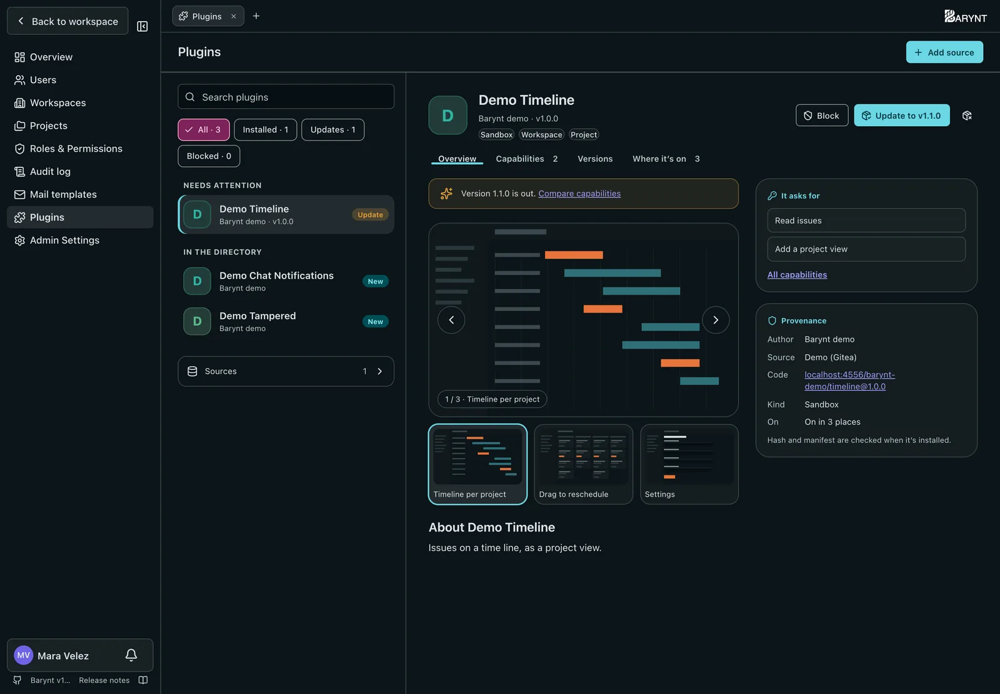
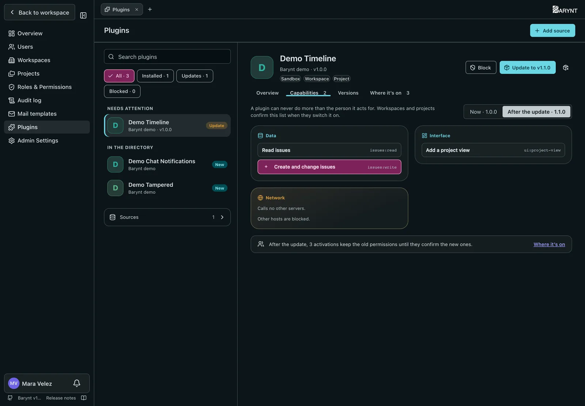

Plugins add to Barynt: a project view, a dashboard widget, a sync with another tool. They come from a **directory**, a list of plugins with the address of each one's code. Two steps keep it in your hands:

1. A **platform administrator** installs a plugin on the server. That switches nothing on.
2. A **workspace or project admin** switches it on where they want it, after confirming what it may do there.

> [!NOTE]
> A plugin never does more than the person using it may. What it asks for (its _capabilities_, such as "Read issues") is shown before anyone installs or switches it on, and it can't use anything that wasn't confirmed.

## Installing (platform administrators)

Open **Admin → Plugins**. On the left is every plugin: what **needs attention** (an update, a blocked plugin), what's **installed** and what your sources offer **in the directory**, with a search and filters. The button at the end of the search field narrows the list by category, kind, where a plugin is usable and source. On the right is the plugin you picked.

With no plugin picked, the right side is the store's start page: how many plugins are installed and switched on, waiting updates, what the directory offers and whether every source can be read. Below are the plugins the directory **features**, what's **new in the directory** and **all plugins** by category.

1. **Add source:** the Git address of a repository with a `plugins.json` in its root, on GitHub, GitLab, Gitea/Forgejo or Bitbucket, including self-hosted servers. Barynt recognizes the provider from the address; if it can't, pick it. Optionally name a branch or tag. On a plain web server, enter the address of the `plugins.json` itself and pick **Web server (HTTPS)**. **Check connection** reads the directory before you save.

   For a private repository, add credentials (an access token, or `user:password` for Bitbucket app passwords and web servers). They are stored encrypted and only sent to that source's server, never to plugins hosted elsewhere.

   > [!NOTE]
   > A Git server on your internal network is blocked unless your operator lists it in `PLUGIN_INTERNAL_HOSTS`.
2. Pick a plugin from **In the directory**. Its page shows its logo and screenshots, its description, links to its docs and community, what it asks for and where the code comes from — before you install anything. Click a screenshot to see it full screen; the arrows, the arrow keys or a swipe step through them, <kbd>Esc</kbd> closes. The newest real release is preselected, even when a newer beta exists; pick another version from the dropdown, where releases and betas are listed under their own headings. A version that needs a newer Barynt is shown too, with a note, but can't be installed.
3. Click **Install**. Barynt loads that version and checks it: the files must match what the directory lists, and the version must run on your Barynt. If anything doesn't match, it is not installed.
4. The dialog shows the plugin's screenshots, if it has any, then the author, where the code comes from, its kind, where it can be used, what it asks for and which other servers it may call. Tick the box and install.

| Action | What it does |
| --- | --- |
| **Update** | A plugin with a newer release is under **Needs attention** and shows **Update to …**. A beta is only offered as an update to a plugin that's on a beta already. Workspaces and projects keep using it. If the update asks for more than before, they have to confirm again; until then it only does what was confirmed. |
| **Back to v…** | Returns to the version before. The newer one stays installed. |
| **Block** | Stops the plugin everywhere at once. Activations and data stay and apply again when you unblock it. |
| **Uninstall** | Removes every version. You choose whether its data in workspaces and projects is deleted too, or kept switched off. |

The icon button at the top right of a plugin's page shares it. The dialog has the plugin's address to copy, HTML for your website — a plain link with its name — and icon buttons for LinkedIn, X, Facebook, WhatsApp, Telegram, Reddit, XING and Bluesky. It shares the plugin's own address, its homepage or its repository; a plugin without one shares the page in Barynt, which only opens for people who are signed in, and the dialog says so. Where your browser has a share sheet of its own, **More apps …** opens it.

A plugin's page has four tabs:

- **Overview:** screenshots, description, what it asks for and where it comes from.
- **Capabilities:** everything it may do, by data, interface and events, and which other servers it calls. With an update waiting, switch between **Now** and **After the update** to see what's added (+) and what goes (−) before you update.
- **Versions:** the available, active and earlier versions with their release notes, if the directory has any, and **Update**, **Back to v…** and older releases to install.
- **Where it's on:** every workspace that has it on or released it for projects, and its projects.

**Sources** at the bottom of the list shows each source with its provider, when it was last read and any error. A directory is read at most every few minutes; **Fetch now** reads it again right away.

Every step is recorded in the [audit log](audit.md).

## Switching on (workspace managers and project admins)

Two steps: the workspace releases a plugin, then each project switches it on in its own settings.

### Releasing in the plugin store

Open **Settings** and pick **Plugin store** in the switcher at the top, next to Personal, Project and Workspace. Only the workspace's managers see it — whoever has the permission _Switch installed plugins on and off and configure them_ in the workspace (owners, admins and managers) — and only once a plugin is installed on the server. A platform admin sees it before that too, with a start page on how plugins are installed.

The store lists every plugin your platform admin installed, with search, categories, screenshots and what it may do. If you belong to several workspaces, pick one at the top of the list, the same way as in the workspace settings. Open a plugin; a line under its name says whether it's released in this workspace and in which projects it's on.

**Release** shows what the plugin may do; confirm it and it's released. A plugin for workspaces then runs in the workspace; a plugin for projects shows up in every project's settings. After an update that asks for more, the line under the name offers **Confirm again**.

**Take back release** switches the plugin off in the workspace and every one of its projects, and it leaves the project settings. Settings and data stay.

### Switching on in a project

A released plugin for projects has an entry under **Plugins** in every project's settings, below the other sections. Project admins open it, check what it may do in the project and **Switch on**. Once it runs, the page holds the form the plugin brings (a channel name, a person to assign, labels, days of the week, …) and, at the bottom, switching it off again — its settings and data stay until **Delete data**.

### Where plugins show

A plugin that brings its own views or pages shows them in the sidebar, each with the plugin's mark:

- **Switched on in a project**: under the project, next to its Dashboard, Board and Issues; pages below a **Plugins** heading.
- **Switched on in the workspace**: views in the sidebar's top group, next to the workspace's Dashboard and Board (on a phone in the **Plugins** section); pages in a **Plugins** section of their own.

A plugin's page always names the plugin under its title.

A plugin can also bring **dashboard widgets**: on a dashboard, **Add widget** lists them under **Plugins**, with a live preview. Some are templates made of Barynt's own building blocks: once added, such a widget is the dashboard's own custom widget — it stays when the plugin is switched off, and **Customize** lets you change it before adding. And some plugins draw their **settings page** themselves — the page under **Plugins** in the settings then shows the plugin's own form; what it saves is checked by Barynt like any other setting. Others add a part below Barynt's form — a connection check, say.

Plugins can also bring **building blocks** for custom widgets: in the widget builder, **Add block** lists them next to Barynt's own, each with the settings it brings. If the plugin is switched off, the block says so and the rest of the widget stays.

Some plugins show a **panel in every issue** of a project where they're on — below the attachments, with the plugin's name. Fold one you don't need; it stays folded for you. Some plugins add a section to the issue's sidebar instead — "Development" with the branch, the merge request and the pipeline, next to the issue's fields. Others put **badges** on the board's cards and the list's rows — a due date, an open merge request. **Display** lists them under *Plugin badges*; switch off the ones you don't want. Some show a whole line on a card — a merge request with its state and pipeline, say. Clicking such a line can open the issue right at the plugin's panel.

Plugins can also add **actions** — "Re-run pipeline", "Close merge request" — to an issue's **…** menu, to a card's quick actions and to the command palette while an issue is open. One that can't be undone asks first.

### A plugin's settings in the workspace

A plugin running in the workspace that has settings gets an entry under **Plugins** in the workspace settings, with its form.

### Connecting to GitHub

A plugin that works with GitHub can be connected instead of everyone keeping a token. Under **Plugins** in the workspace settings (or a project's), **Connect GitHub** goes to GitHub: sign in, install the instance's GitHub App on an organization and pick the repositories it may see there — or pick an account where it's installed already. A connection in the workspace counts for every project in it; the project then only ticks which repositories it works with. GitHub reports to Barynt through the app, so no webhook has to be added per repository. A platform admin creates the app once, on the plugin's page under **Admin → Plugins**. See [GitHub](../integrations/github.md).

### Credentials

A plugin that talks to another service — a Git host, a chat — may need an access token for it. Depending on the plugin you keep it in one of three places:

- **For the whole workspace**: in the workspace settings, on the plugin's page under **Plugins** (workspace managers).
- **Per project**: in the project's settings, on the plugin's page (project admins).
- **Your own**: in your personal settings under **Plugins**, when the plugin acts with each person's own account.

Barynt keeps the value encrypted and adds it to the plugin's requests to that service itself — the plugin never sees it, and nobody sees it again once it's saved: the page only says whether one is kept, and since when. **Remove** takes it back; the plugin's requests to that service fail until someone keeps a new one. Keeping or removing a workspace's or project's credential lands in the audit log (which one, never the value).

## Installing (platform administrators)

Open **Admin → Plugins**. On the left is every plugin: what **needs attention** (an update, a blocked plugin), what's **installed** and what your sources offer **in the directory**, with a search and filters. The button at the end of the search field narrows the list by category, kind, where a plugin is usable and source. On the right is the plugin you picked.

With no plugin picked, the right side is the store's start page: how many plugins are installed and switched on, waiting updates, what the directory offers and whether every source can be read. Below are the plugins the directory **features**, what's **new in the directory** and **all plugins** by category.

1. **Add source:** the Git address of a repository with a `plugins.json` in its root, on GitHub, GitLab, Gitea/Forgejo or Bitbucket, including self-hosted servers. Barynt recognizes the provider from the address; if it can't, pick it. Optionally name a branch or tag. On a plain web server, enter the address of the `plugins.json` itself and pick **Web server (HTTPS)**. **Check connection** reads the directory before you save.

   For a private repository, add credentials (an access token, or `user:password` for Bitbucket app passwords and web servers). They are stored encrypted and only sent to that source's server, never to plugins hosted elsewhere.

   > [!NOTE]
   > A Git server on your internal network is blocked unless your operator lists it in `PLUGIN_INTERNAL_HOSTS`.
2. Pick a plugin from **In the directory**. Its page shows its logo and screenshots, its description, links to its docs and community, what it asks for and where the code comes from — before you install anything. Click a screenshot to see it full screen; the arrows, the arrow keys or a swipe step through them, <kbd>Esc</kbd> closes. The newest real release is preselected, even when a newer beta exists; pick another version from the dropdown, where releases and betas are listed under their own headings. A version that needs a newer Barynt is shown too, with a note, but can't be installed.
3. Click **Install**. Barynt loads that version and checks it: the files must match what the directory lists, and the version must run on your Barynt. If anything doesn't match, it is not installed.
4. The dialog shows the plugin's screenshots, if it has any, then the author, where the code comes from, its kind, where it can be used, what it asks for and which other servers it may call. Tick the box and install.

| Action | What it does |
| --- | --- |
| **Update** | A plugin with a newer release is under **Needs attention** and shows **Update to …**. A beta is only offered as an update to a plugin that's on a beta already. Workspaces and projects keep using it. If the update asks for more than before, they have to confirm again; until then it only does what was confirmed. |
| **Back to v…** | Returns to the version before. The newer one stays installed. |
| **Block** | Stops the plugin everywhere at once. Activations and data stay and apply again when you unblock it. |
| **Uninstall** | Removes every version. You choose whether its data in workspaces and projects is deleted too, or kept switched off. |

The icon button at the top right of a plugin's page shares it. The dialog has the plugin's address to copy, HTML for your website — a plain link with its name — and icon buttons for LinkedIn, X, Facebook, WhatsApp, Telegram, Reddit, XING and Bluesky. It shares the plugin's own address, its homepage or its repository; a plugin without one shares the page in Barynt, which only opens for people who are signed in, and the dialog says so. Where your browser has a share sheet of its own, **More apps …** opens it.

A plugin's page has four tabs:

- **Overview:** screenshots, description, what it asks for and where it comes from.
- **Capabilities:** everything it may do, by data, interface and events, and which other servers it calls. With an update waiting, switch between **Now** and **After the update** to see what's added (+) and what goes (−) before you update.
- **Versions:** the available, active and earlier versions with their release notes, if the directory has any, and **Update**, **Back to v…** and older releases to install.
- **Where it's on:** every workspace that has it on or released it for projects, and its projects.

**Sources** at the bottom of the list shows each source with its provider, when it was last read and any error. A directory is read at most every few minutes; **Fetch now** reads it again right away.

Every step is recorded in the [audit log](audit.md).

## Switching on (workspace and project admins)

Open **Settings** and pick **Plugin store** in the switcher at the top, next to Personal, Project and Workspace. You see it if you have the permission _Switch installed plugins on and off and configure them_ in the workspace or in one of its projects; owners, admins, managers and project admins have it.

The store lists every plugin your platform admin installed, with search, categories, screenshots and what it may do. If you belong to several workspaces, pick one at the top of the list, the same way as in the workspace settings. Open a plugin; a line under its name says whether it's released in this workspace and in which projects it's on.

**Add** and **Edit** open one window with two steps:

1. **Release:** a workspace admin releases the plugin for the workspace. Then it runs in the workspace (if it has a workspace part) and projects may switch it on.
2. **Switch on in projects:** tick each project you manage where it should run. Until it's released, this step is locked. Untick a project to switch it off there; its settings and data stay, and a bin next to it deletes them.

Wherever it newly runs, you confirm once what it may do. After an update that asks for more, those places wait for a confirmation and the window offers it.

Taking the release back switches the plugin off in the workspace and every one of its projects; their data stays.

### A plugin's settings

A switched-on plugin that has settings gets an entry under **Plugins** in the workspace's or project's settings, below the other sections. Its page holds the form the plugin brings (a channel name, what to post, …) and, at the bottom, switching it off there.

### A plugin's server

Some plugins also run on a server of their maker — to post to a chat, start a build or keep another tool in step. The store lists what such a plugin hears about (for example "Hear about issue changes"), and you confirm it like any other capability. Once it's switched on, Barynt sends the plugin's server those events, signed, and tries again when it's down — the same as a [webhook](../integrations/webhooks.md). It only hears about what its confirmed capabilities allow, never about a private project unless it was switched on there, and never about its own changes.

Who runs that server is the plugin's maker's choice, and the store says which: the maker for every Barynt, **whoever runs this Barynt** — then a platform admin enters its address on the plugin's page under **Admin → Plugins** (or `PLUGIN_SERVICE_URLS` sets it) — or **whoever switches it on**, for that workspace or project alone, who enters the address in the plugin's settings. Until there's an address the plugin runs without its server. **Test connection** sends it its sign-up again.

The plugin's settings show a **Server** card: the address, the events, how the last delivery went, and **Deliveries** with the log of the last seven days. When every delivery has failed for a day, Barynt **pauses** them — the plugin stays on, the pause lands in the activity log, and **Send again** resumes. Events from the pause aren't sent later.

### Webhooks from other services

A plugin can ask to receive webhooks from another service — GitLab, GitHub — through Barynt ("Receive webhooks from other services"). Once it's switched on, its settings show each such webhook with an **address** and a **secret**, and how to enter them at GitLab or GitHub. Barynt checks every call against the secret and refuses the rest; the card shows when the last call came and how it went. For GitHub, Barynt can also read the calls itself: pull requests, branches, commits and checks then appear on the issues they name (`WEB-42` in a branch, title or commit message), with no server of the plugin in between. Such a webhook can have **rules** — for example "When a pull request is merged" → *Done*: pick the status per rule in the plugin's settings, or leave it off. Barynt then sets it as the plugin's app and comments why, but only for an issue the pull request works on: its key in the branch's name, or after "Fixes", "Closes" or "Resolves" in the title or description. A key only mentioned elsewhere links the pull request and nothing more. The [GitHub plugin](../integrations/github.md) is built on this.

### Apps

Such a plugin also acts in Barynt — writes a comment, moves an issue — under its own name, as an **app**: "Demo Chat Notifications (App)" shows as the author wherever it did something. An app isn't a member and can't sign in, can't be assigned or mentioned, and never manages anything (roles, members, settings, plugins). It may only do what the capabilities you confirmed allow, in the workspace's public projects — or, switched on in a project, only there. **Members → Apps** lists them: where each acts, what it may, when it was last active. Switching the plugin off stops its app at once.

## Building your own

To write a plugin yourself, see [Building plugins](../../../dev/plugins.md) in the developer docs.
