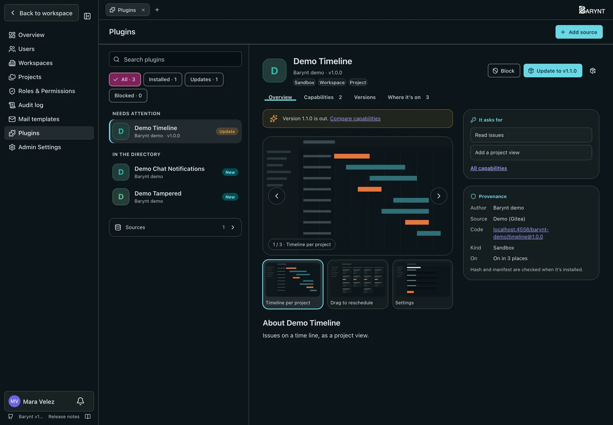
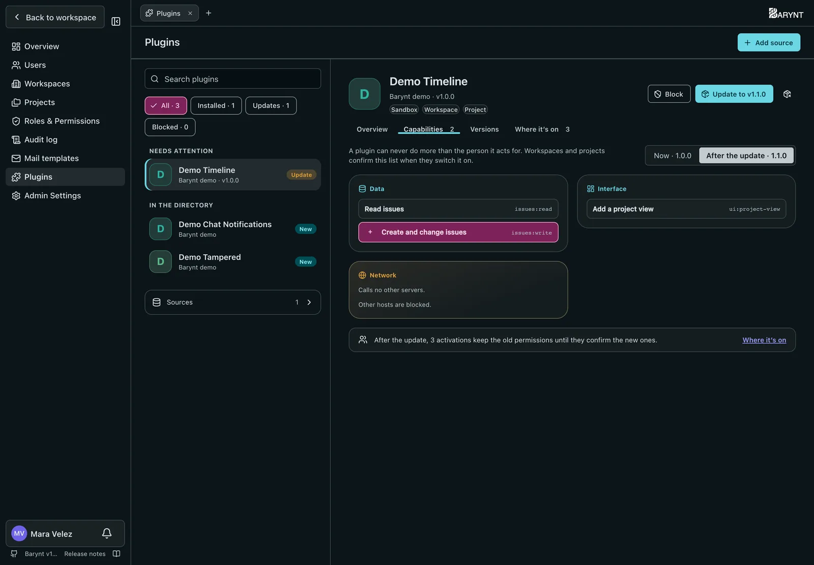

Plugins add to Barynt: a project view, a dashboard widget, a sync with another tool. They come from a **directory**, a list of plugins with the address of each one's code. Two steps keep it in your hands:

1. A **platform administrator** installs a plugin on the server. That switches nothing on.
2. A **workspace or project admin** switches it on where they want it, after confirming what it may do there.

> [!NOTE]
> A plugin never does more than the person using it may. What it asks for (its _capabilities_, such as "Read issues") is shown before anyone installs or switches it on, and it can't use anything that wasn't confirmed.

## Installing (platform administrators)

Open **Admin → Plugins**. On the left is every plugin: what **needs attention** (an update, a blocked plugin), what's **installed** and what your sources offer **in the directory**, with a search and filters. On the right is the plugin you picked.

With no plugin picked, the right side is the store's start page: how many plugins are installed and switched on, waiting updates, what the directory offers and whether every source can be read. Below are the plugins the directory **features**, what's **new in the directory** and **all plugins** by category.

1. **Add source:** the Git address of a repository with a `plugins.json` in its root, on GitHub, GitLab, Gitea/Forgejo or Bitbucket, including self-hosted servers. Barynt recognizes the provider from the address; if it can't, pick it. Optionally name a branch or tag. On a plain web server, enter the address of the `plugins.json` itself and pick **Web server (HTTPS)**. **Check connection** reads the directory before you save.

   For a private repository, add credentials (an access token, or `user:password` for Bitbucket app passwords and web servers). They are stored encrypted and only sent to that source's server, never to plugins hosted elsewhere.

   > [!NOTE]
   > A Git server on your internal network is blocked unless your operator lists it in `PLUGIN_INTERNAL_HOSTS`.
2. Pick a plugin from **In the directory**. Its page shows the screenshots, what it asks for and where the code comes from. Choose a version if you don't want the newest.
3. Click **Install**. Barynt loads that version and checks it: the files must match what the directory lists, and the version must run on your Barynt. If anything doesn't match, it is not installed.
4. The dialog shows the plugin's screenshots, if it has any, then the author, where the code comes from, its kind, where it can be used, what it asks for and which other servers it may call. Tick the box and install.

| Action | What it does |
| --- | --- |
| **Update** | A plugin with a newer version is under **Needs attention** and shows **Update to …**. Workspaces and projects keep using it. If the update asks for more than before, they have to confirm again; until then it only does what was confirmed. |
| **Back to v…** | Returns to the version before. The newer one stays installed. |
| **Block** | Stops the plugin everywhere at once. Activations and data stay and apply again when you unblock it. |
| **Uninstall** | Removes every version. You choose whether its data in workspaces and projects is deleted too, or kept switched off. |

A plugin's page has four tabs:

- **Overview:** screenshots, description, what it asks for and where it comes from.
- **Capabilities:** everything it may do, by data, interface and events, and which other servers it calls. With an update waiting, switch between **Now** and **After the update** to see what's added (+) and what goes (−) before you update.
- **Versions:** the available, active and earlier versions with their release notes, if the directory has any, and **Update**, **Back to v…** and older releases to install.
- **Where it's on:** every workspace that has it on or released it for projects, and its projects.

**Sources** at the bottom of the list shows each source with its provider, when it was last read and any error. A directory is read at most every few minutes; **Fetch now** reads it again right away.

Every step is recorded in the [audit log](audit.md).

## Switching on (workspace managers and project admins)

Two steps: the workspace releases a plugin, then each project switches it on in its own settings.

### Releasing in the plugin store

Open **Settings** and pick **Plugin store** in the switcher at the top, next to Personal, Project and Workspace. Only the workspace's managers see it — whoever has the permission _Switch installed plugins on and off and configure them_ in the workspace (owners, admins and managers).

The store lists every plugin your platform admin installed, with search, categories, screenshots and what it may do. If you belong to several workspaces, pick one at the top of the list, the same way as in the workspace settings. Open a plugin; a line under its name says whether it's released in this workspace and in which projects it's on.

**Release** shows what the plugin may do; confirm it and it's released. A plugin for workspaces then runs in the workspace; a plugin for projects shows up in every project's settings. After an update that asks for more, the line under the name offers **Confirm again**.

**Take back release** switches the plugin off in the workspace and every one of its projects, and it leaves the project settings. Settings and data stay.

### Switching on in a project

A released plugin for projects has an entry under **Plugins** in every project's settings, below the other sections. Project admins open it, check what it may do in the project and **Switch on**. Once it runs, the page holds the form the plugin brings (a channel name, what to post, …) and, at the bottom, switching it off again — its settings and data stay until **Delete data**.

### A plugin's settings in the workspace

A plugin running in the workspace that has settings gets an entry under **Plugins** in the workspace settings, with its form.

## Installing (platform administrators)

Open **Admin → Plugins**. On the left is every plugin: what **needs attention** (an update, a blocked plugin), what's **installed** and what your sources offer **in the directory**, with a search and filters. On the right is the plugin you picked.

With no plugin picked, the right side is the store's start page: how many plugins are installed and switched on, waiting updates, what the directory offers and whether every source can be read. Below are the plugins the directory **features**, what's **new in the directory** and **all plugins** by category.

1. **Add source:** the Git address of a repository with a `plugins.json` in its root, on GitHub, GitLab, Gitea/Forgejo or Bitbucket, including self-hosted servers. Barynt recognizes the provider from the address; if it can't, pick it. Optionally name a branch or tag. On a plain web server, enter the address of the `plugins.json` itself and pick **Web server (HTTPS)**. **Check connection** reads the directory before you save.

   For a private repository, add credentials (an access token, or `user:password` for Bitbucket app passwords and web servers). They are stored encrypted and only sent to that source's server, never to plugins hosted elsewhere.

   > [!NOTE]
   > A Git server on your internal network is blocked unless your operator lists it in `PLUGIN_INTERNAL_HOSTS`.
2. Pick a plugin from **In the directory**. Its page shows the screenshots, what it asks for and where the code comes from. Choose a version if you don't want the newest.
3. Click **Install**. Barynt loads that version and checks it: the files must match what the directory lists, and the version must run on your Barynt. If anything doesn't match, it is not installed.
4. The dialog shows the plugin's screenshots, if it has any, then the author, where the code comes from, its kind, where it can be used, what it asks for and which other servers it may call. Tick the box and install.

| Action | What it does |
| --- | --- |
| **Update** | A plugin with a newer version is under **Needs attention** and shows **Update to …**. Workspaces and projects keep using it. If the update asks for more than before, they have to confirm again; until then it only does what was confirmed. |
| **Back to v…** | Returns to the version before. The newer one stays installed. |
| **Block** | Stops the plugin everywhere at once. Activations and data stay and apply again when you unblock it. |
| **Uninstall** | Removes every version. You choose whether its data in workspaces and projects is deleted too, or kept switched off. |

A plugin's page has four tabs:

- **Overview:** screenshots, description, what it asks for and where it comes from.
- **Capabilities:** everything it may do, by data, interface and events, and which other servers it calls. With an update waiting, switch between **Now** and **After the update** to see what's added (+) and what goes (−) before you update.
- **Versions:** the available, active and earlier versions with their release notes, if the directory has any, and **Update**, **Back to v…** and older releases to install.
- **Where it's on:** every workspace that has it on or released it for projects, and its projects.

**Sources** at the bottom of the list shows each source with its provider, when it was last read and any error. A directory is read at most every few minutes; **Fetch now** reads it again right away.

Every step is recorded in the [audit log](audit.md).

## Switching on (workspace and project admins)

Open **Settings** and pick **Plugin store** in the switcher at the top, next to Personal, Project and Workspace. You see it if you have the permission _Switch installed plugins on and off and configure them_ in the workspace or in one of its projects; owners, admins, managers and project admins have it.

The store lists every plugin your platform admin installed, with search, categories, screenshots and what it may do. If you belong to several workspaces, pick one at the top of the list, the same way as in the workspace settings. Open a plugin; a line under its name says whether it's released in this workspace and in which projects it's on.

**Add** and **Edit** open one window with two steps:

1. **Release:** a workspace admin releases the plugin for the workspace. Then it runs in the workspace (if it has a workspace part) and projects may switch it on.
2. **Switch on in projects:** tick each project you manage where it should run. Until it's released, this step is locked. Untick a project to switch it off there; its settings and data stay, and a bin next to it deletes them.

Wherever it newly runs, you confirm once what it may do. After an update that asks for more, those places wait for a confirmation and the window offers it.

Taking the release back switches the plugin off in the workspace and every one of its projects; their data stays.

### A plugin's settings

A switched-on plugin that has settings gets an entry under **Plugins** in the workspace's or project's settings, below the other sections. Its page holds the form the plugin brings (a channel name, what to post, …) and, at the bottom, switching it off there.
