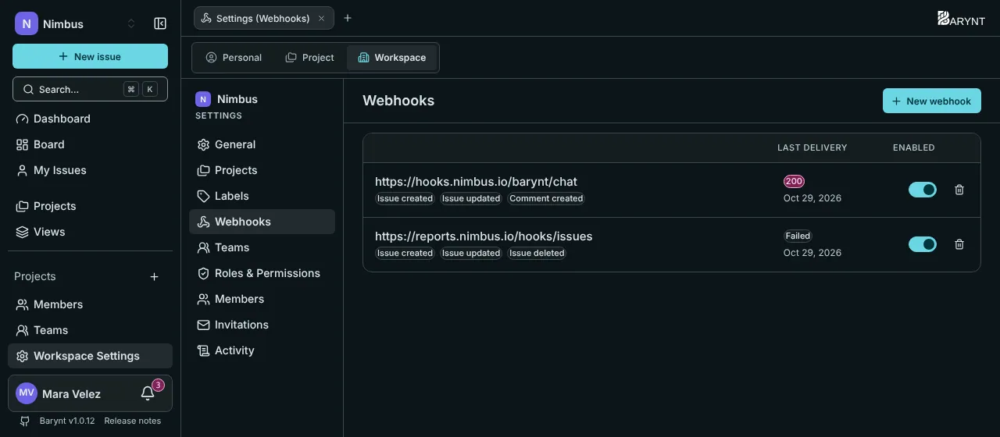
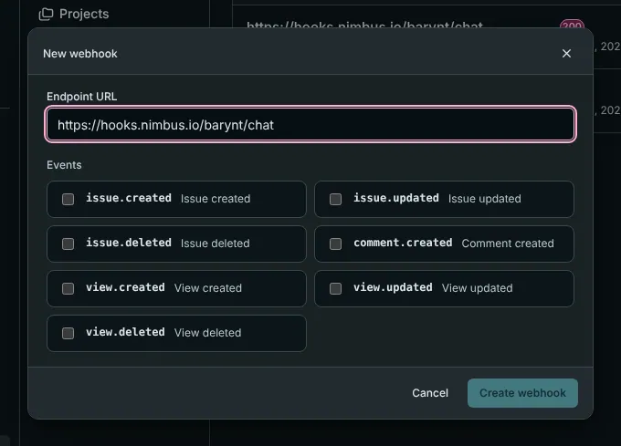

With a **webhook**, Barynt calls **you**. Whenever something you care about happens in the workspace, it sends a message to an address you choose. That is how you post new bugs into a chat channel, start a build when an issue moves to _In Review_, or keep another system up to date without checking again and again.



## Examples of what teams do with it

- **Chat notifications:** a message in your team channel for every new _Urgent_ bug.
- **Automation:** when an issue is created with the label `Customer`, open a ticket in the support system.
- **Reporting:** copy every change into a data warehouse.
- **Syncing** a spreadsheet, a status page or a customer portal.

Some of these need a developer, or a tool like Zapier, Make or n8n that can receive a webhook. The settings page itself needs no code.

## Setting one up

Open **Workspace settings → Webhooks** (you need the permission to manage webhooks, which owners, admins and managers have) and click **New webhook**.



1. **Endpoint URL:** the address that should receive the messages, for example `https://example.com/webhooks/barynt`. It must start with `https://` or `http://`. Use HTTPS, because the messages carry the content of your issues.
2. **Events:** choose what you want to hear about, at least one. They are grouped (issues, comments, labels, projects, members, views); the switch next to a group picks all of it.
3. Click **Create webhook**. Barynt shows the **secret** once: copy it now. The receiver needs it to check that a message really came from your Barynt.

The list shows each webhook with the events it listens to, its **last delivery** (the HTTP status, or the error) and a switch to turn it **on or off**. A webhook that has never delivered anything says so ("Never delivered"). **Deleting** one stops it immediately.

A webhook's address and events cannot be edited afterwards. To change them, create a new webhook and delete the old one. The same goes for a **new secret**, for example after it leaked: delete the webhook and create it again.

Webhooks belong to **one workspace** and only report events of that workspace. Every change counts, whoever made it and wherever: in the app, through the [REST API](api.md), by an AI assistant through [MCP](mcp.md) or by a plugin.

## Events

| Event | When |
| --- | --- |
| `issue.created` | An issue is created. |
| `issue.updated` | Anything on an issue changes, also a drag to another column on the board. The message carries the **whole current issue** and, in `changes`, what changed from what to what. |
| `issue.status_changed` | The status changes. Sent in addition to `issue.updated`, for receivers that only care about this. |
| `issue.assigned` | Someone else, or nobody, is assigned. Also in addition to `issue.updated`. |
| `issue.fields_changed` | A custom field changes. Also in addition to `issue.updated`. |
| `issue.deleted` | An issue is deleted. The message is a short snapshot (id, reference, project, title). |
| `comment.created`, `comment.updated`, `comment.deleted` | A comment is written (also a reply), edited or deleted. |
| `label.created`, `label.updated`, `label.deleted` | A label of the workspace or a project is created, renamed or recolored, or deleted. |
| `project.created`, `project.updated`, `project.archived`, `project.unarchived`, `project.deleted` | A project is created, changed (name, identifier, color, visibility), archived, restored or deleted. |
| `member.added`, `member.removed`, `member.role_changed` | Someone joins or leaves the workspace or a project, or gets another role. An invitation counts once it is accepted. The message has no email address. |
| `view.created`, `view.updated`, `view.deleted` | A **shared** view changes. Private views never trigger anything. |

Every event with a complete example message is on the page [Webhook events](../api-reference/webhook-events.md).

## What a message looks like

Barynt sends an HTTP `POST` with these headers and a JSON body:

| Header | Content |
| --- | --- |
| `Content-Type` | `application/json` |
| `X-Barynt-Event` | The event, the same as `event` in the body. |
| `X-Barynt-Timestamp` | When the message was sent, in milliseconds since 1970. |
| `X-Barynt-Signature` | The signature of the message, made with your secret. |

```json
{
  "event": "issue.updated",
  "timestamp": 1772870400000,
  "workspaceId": "ws_1a2b3c",
  "projectId": "proj_9f8e7d",
  "actor": { "id": "u_1a2b3c", "name": "Alex Kim" },
  "via": null,
  "data": {
    "id": "i_4k2n1x",
    "ref": "WEB-42",
    "title": "Fix broken checkout flow",
    "status": "done",
    "statusCategory": "completed",
    "assignee": { "id": "u_7h3j2k", "name": "Priya Shah" },
    "project": { "id": "proj_9f8e7d", "name": "Website Relaunch" }
  },
  "changes": {
    "status": { "from": "in-progress", "to": "done" },
    "statusCategory": { "from": "started", "to": "completed" }
  }
}
```

- `event` says what happened and `timestamp` when.
- `workspaceId` and `projectId` say where. `projectId` is `null` for something that belongs to the whole workspace, such as a workspace label or member.
- `actor` is who did it (`null` when nobody did, for example someone who joined through the company's email domain). `via` names the plugin when the change came through one.
- `data` carries the issue, comment, label, project, member or view in the same shape as in the [REST API](../api-reference/issues.md).
- `changes` only comes with a change: each field with its old and new value. A custom field is listed as `customFields.<key>`.

## Checking that a message is genuine

Anybody who knows the receiving address could send fake messages to it. That is why every delivery is **signed**. The receiver computes the same signature and compares:

```text
signature = hex( HMAC-SHA256( secret, timestamp + "." + rawBody ) )
```

Use the **raw body exactly as received**, before any JSON parsing, and the `X-Barynt-Timestamp` header. The signature is hex-encoded, without a prefix. In Node.js:

```js
import { createHmac, timingSafeEqual } from "node:crypto";

function isGenuine(secret, timestamp, rawBody, signature) {
  const expected = createHmac("sha256", secret)
    .update(`${timestamp}.${rawBody}`) // timestamp, a dot, the raw body
    .digest("hex");
  const a = Buffer.from(expected);
  const b = Buffer.from(signature);
  return a.length === b.length && timingSafeEqual(a, b);
}
```

In Python:

```python
import hmac, hashlib

def is_genuine(secret: str, timestamp: str, raw_body: bytes, signature: str) -> bool:
    expected = hmac.new(secret.encode(), f"{timestamp}.".encode() + raw_body, hashlib.sha256).hexdigest()
    return hmac.compare_digest(expected, signature)
```

Also reject messages whose timestamp is older than a few minutes (say five). That stops someone replaying an old message: because the timestamp is part of what is signed, they cannot simply change it.

A complete little receiver, with Express:

```js
import express from "express";

const app = express();
app.post("/webhooks/barynt", express.raw({ type: "application/json" }), (req, res) => {
  const timestamp = req.get("X-Barynt-Timestamp");
  const signature = req.get("X-Barynt-Signature");
  const fresh = Math.abs(Date.now() - Number(timestamp)) < 5 * 60 * 1000;
  if (!fresh || !isGenuine(process.env.BARYNT_WEBHOOK_SECRET, timestamp, req.body.toString(), signature)) {
    return res.sendStatus(401);
  }
  const { event, data } = JSON.parse(req.body);
  console.log(event, data.ref ?? data.id);
  res.sendStatus(204); // answer quickly, do the slow work afterwards
});
app.listen(3000);
```

## Delivery: what to expect

- **Answer with a `2xx` within ten seconds.** That counts as delivered. Do slow work afterwards.
- **Barynt tries again** when there is no answer, a timeout, a `5xx`, or `408`, `409` or `429`: after 1 minute, 5 minutes, 30 minutes, 2 hours and 6 hours, six attempts in all over about nine hours. Any other `4xx` means "no" and is not retried; neither is a redirect, because Barynt does not follow them.
- **Recognising a repeat:** every attempt of the same message has the same `X-Barynt-Delivery` id and body; `X-Barynt-Attempt` counts up. A message can arrive twice (for example when your receiver handled it but answered too late), so skip an id you have already handled.
- **After a day of failures the webhook is turned off.** When every delivery has failed for 24 hours, Barynt switches the webhook off, writes it to the activity log and emails whoever created it. The list says so. Turn it on again once the receiver works; events from the time it was off are not sent.
- **The log** (the clock icon next to a webhook) shows the deliveries of the last seven days: event, time, state (delivered, retry at …, given up), the answer or error, how long it took and what was sent. **Send again** sends one once more, with the same id.
- **No order guarantee.** Two quick changes can arrive in either order, and a retry arrives later than newer messages. Use the time in the data (for an issue, `updated`) to tell which is newer, and treat `timestamp` as the time of sending.
- **For things that must not be missed**, reconcile now and then through the [REST API](api.md) (for example once a night): a webhook that was off or a message that was given up on is not sent later.
- **Your server must be reachable** from the Barynt server, at a **public** address. A receiver on your laptop is not, unless you use a tunnelling tool such as ngrok while testing.
- **No private addresses.** Barynt refuses to send to `localhost`, to addresses of its own network (`10.…`, `192.168.…`, `172.16–31.…`) and to cloud metadata addresses, and it connects to exactly the address it checked. This keeps a webhook from reaching into the network Barynt runs in. If your receiver really is internal (an n8n in the company network), the administrator lists it in `WEBHOOK_INTERNAL_HOSTS`, see [Configuration](../getting-started/config.md).

## Trying it out

1. Create a temporary receiver address at a service such as webhook.site, or run the Express example above behind a tunnel.
2. Create a webhook for that address with all events.
3. Create or change an issue in Barynt. The message arrives within a second.
4. Look at the **last delivery** in the list: `200` or `204` means it was received. The log (clock icon) shows the message itself and the answer.

## When nothing arrives

| What you see | Likely cause |
| --- | --- |
| "Never delivered" | Nothing has happened yet that the webhook listens to, or it is turned off, or it belongs to another workspace. |
| An error such as `ECONNREFUSED` or `No answer within 10 s` | The receiver was not reachable or took longer than ten seconds. Check the address, the firewall and TLS certificates. Barynt tries again on its own. |
| `The address is on a private network` | The address points into a private network or at `localhost`. Use a public address, or ask the administrator to allow it (`WEBHOOK_INTERNAL_HOSTS`). |
| "Turned off by Barynt" | Every delivery failed for a day. Fix the receiver, then turn the webhook on again. |
| A status of `4xx`/`5xx` | The receiver was reached but rejected the message. Look at its log: most often the signature check, because the body was changed before checking. |
| Signatures never match | The body was parsed and re-serialised before checking, the wrong secret was used, or the timestamp was left out of the signed string. |

More in [Troubleshooting](../administration/troubleshooting.md).

## Good to know

- A message carries the content of the issue, such as its title and description. Treat the receiving address with care and use **HTTPS**.
- The secret is shown once and stored so Barynt can sign each message. Keep it in the receiver's configuration, not in code that is shared.
