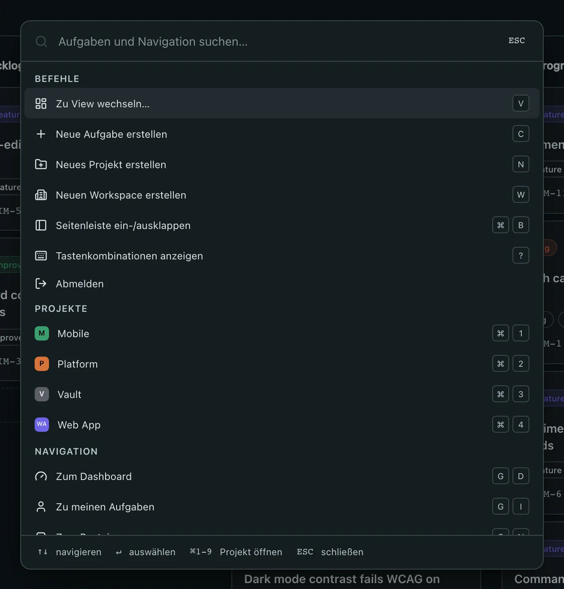
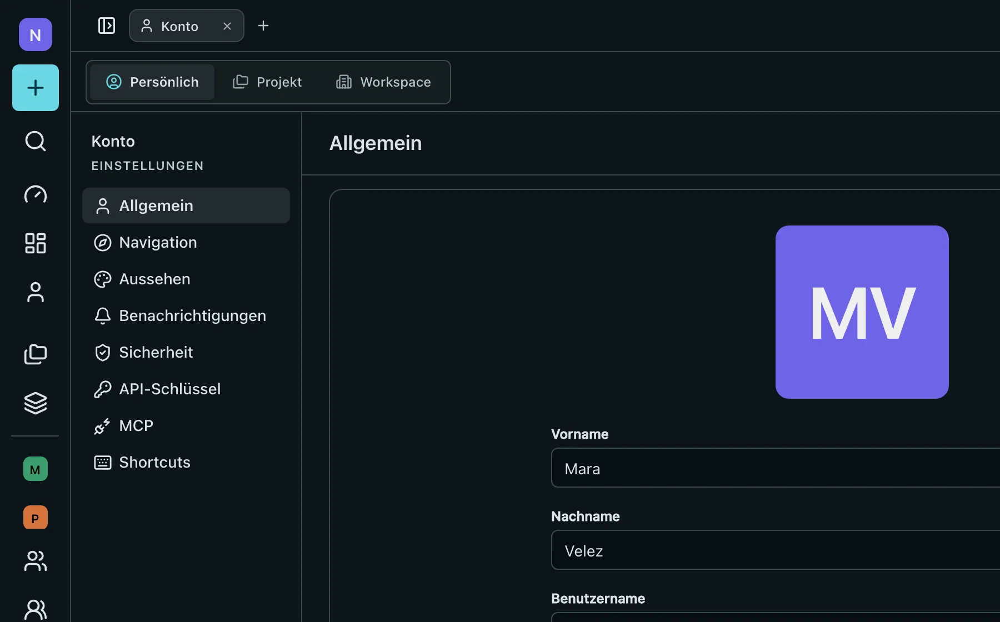

# Barynt 1.0.1

**Schneller durch Barynt.** Die Befehlspalette legt jetzt Projekte und Workspaces an, erreicht alle wichtigen Seiten und zeigt zu jedem Eintrag die passende Tastenkombination. Fünf neue Kürzel führen zum Posteingang, zu den Views, zu deinem Konto und zu den Mitgliedern und Einstellungen des Workspaces. Dazu Fehlerbehebungen für Passkeys, die Seitenleiste und die Navigation in den Einstellungen.

## ✨ Highlights

- **Anlegen aus der Palette** — `⌘K`, dann „Neues Projekt erstellen“ oder „Neuen Workspace erstellen“. Beides erscheint nur, wenn du das darfst.
- **Alle Kürzel auf einen Blick** — jeder Eintrag in der Palette zeigt die Tasten, die dasselbe tun, auch deine eigenen Belegungen.
- **Neue Kürzel** — `W` legt einen Workspace an, `G N` öffnet den Posteingang, `G V` die Views, `G A` dein Konto, `G U` und `G W` die Mitglieder und Einstellungen des Workspaces.
- **Dein Projekt bleibt in der Seitenleiste offen** — wo immer du in einem Projekt bist, ist sein Eintrag in der Seitenleiste aufgeklappt.
- **Passkeys auf der aktuellen WebAuthn-Bibliothek** — inklusive einer behobenen Sicherheitslücke. Vorhandene Passkeys funktionieren weiter.

## ⌘ Die Befehlspalette

Drücke `⌘K` (`Strg K` unter Windows und Linux) irgendwo in einem Workspace.

- **Neue Befehle:** Projekt erstellen, Workspace erstellen, Seitenleiste ein- und ausklappen und abmelden. Ein Befehl erscheint nur, wenn du ihn nutzen darfst, genau wie in der Seitenleiste.
- **Mehr Ziele:** Dashboard, Projekte, Views und dein Konto kommen zu meinen Aufgaben, Posteingang, Mitgliedern, Teams und Einstellungen dazu. Mitglieder und Einstellungen erscheinen jetzt nur noch für alle, die sie auch öffnen dürfen.
- **Kürzel rechts daneben:** Jeder Eintrag zeigt die Tastenkombination, die dasselbe tut. Hast du unter Konto → Shortcuts ein Kürzel geändert, siehst du deine eigenen Tasten. Auf Handy oder Tablet ohne Tastatur werden keine Kürzel angezeigt.

## ⌨️ Neue Tastenkombinationen

| Tasten  | Wirkung                                                     |
| ------- | ----------------------------------------------------------- |
| `W`     | Neuen Workspace erstellen                                   |
| `G` `N` | Posteingang öffnen                                          |
| `G` `V` | Views öffnen                                                |
| `G` `A` | Dein Konto öffnen                                           |
| `G` `U` | Mitglieder des Workspaces öffnen, auch aus einem Projekt    |
| `G` `W` | Einstellungen des Workspaces öffnen, auch aus einem Projekt |

`G M` und `G S` funktionieren wie bisher: In einem Projekt öffnen sie dessen Mitglieder und Einstellungen. Alle Kürzel findest du unter `?`, ändern kannst du sie unter Konto → Shortcuts.

## 🐛 Fehlerbehebungen

- **Einstellungen bei eingeklappter Seitenleiste.** Wurde die Seitenleiste auf ihre Icons eingeklappt, schrumpfte auch die Navigation in den Einstellungen auf Icons. Sie behält jetzt ihre Beschriftungen.
- **Das aktuelle Projekt in der Seitenleiste.** Ein Projekt klappte nur auf, wenn du auf einer seiner aufgelisteten Seiten warst, und nur auf der ersten geöffneten Seite. Jetzt klappt es überall im Projekt auf, auch auf einer Aufgabe oder nach einem Projektwechsel.
- **Kürzel, die mit `G` beginnen.** Die zweite Taste löste zusätzlich ihr eigenes Kürzel aus: `G P` öffnete auf einer Aufgabe auch die Prioritätsauswahl. Jetzt passiert nur, was das `G`-Kürzel verspricht.
- **Tooltips bei eingeklappter Seitenleiste.** Tooltips außerhalb der Seitenleiste wurden so platziert, als säßen sie darin.

## 🔐 Passkeys und Abhängigkeiten

Passkeys laufen jetzt auf Version 14 der WebAuthn-Bibliothek. Für Version 9 gab es eine Sicherheitswarnung: Bei der Registrierung prüfte sie nicht streng genug, ob das Zertifikat eines Authenticators auf eine vertrauenswürdige Stelle zurückgeht. Für dich ändert sich nichts: Vor dem Update angelegte Passkeys funktionieren weiter, Anmelden und Passkey hinzufügen laufen wie bisher.

Auch Next.js, der Editor, die Mail-Bibliothek und weitere Abhängigkeiten sind auf dem neuesten Stand.

<!-- changes:start -->
### Neue Funktionen

- **palette:** create commands, more destinations and their shortcuts ([`02031a9`](https://github.com/barynt-dev/barynt-web/commit/02031a9bdb9268e0c34878190ec95dad901d8fe9))

### Fehlerbehebungen

- **docker:** run apt-get upgrade fresh on every build ([`1d27754`](https://github.com/barynt-dev/barynt-web/commit/1d277547baa607a67a845bf4b6222f39ee6e5f54))
- **shortcuts:** a key that finishes a g-sequence no longer fires its bare shortcut ([`3021872`](https://github.com/barynt-dev/barynt-web/commit/3021872458a180948bc137a9087b5f80a515058f))
- **sidebar:** expand the current project anywhere inside it ([`532bd54`](https://github.com/barynt-dev/barynt-web/commit/532bd5421a1d86cf8812bc6bcc74275d3e82cf3a))
- **layout:** keep the settings nav expanded while the sidebar is a rail ([`25908b2`](https://github.com/barynt-dev/barynt-web/commit/25908b2f241520603919f86b5ed2e7f076209afd))
- **auth:** keep passkeys working on @simplewebauthn v14 ([`72c58e5`](https://github.com/barynt-dev/barynt-web/commit/72c58e531ab2c45b35220063a5e21c620a484ff8))

Wartung (4)

- **release:** v1.0.1 ([`88c03f4`](https://github.com/barynt-dev/barynt-web/commit/88c03f4b5ffb83fa8b4e5d94260e3db370130b97))
- **release:** notes for 1.0.1 with screenshots ([`dbe7260`](https://github.com/barynt-dev/barynt-web/commit/dbe7260bd7827a2d3b7ffa08293d582e87b48e91))
- apply Biome 2.6.6 formatting, drop unused public assets ([`d6726aa`](https://github.com/barynt-dev/barynt-web/commit/d6726aaff0ab3fde4115b2425a04a3db9aa68a19))
- **deps:** update dependencies, @simplewebauthn to v14 ([`f58fb62`](https://github.com/barynt-dev/barynt-web/commit/f58fb62a92d533393d3d8e79e6043fd31bf80ebf))

**Vorherige Version:** [v1.0.0](https://github.com/barynt-dev/barynt-web/releases/tag/v1.0.0) · **Alle Änderungen:** [v1.0.0…v1.0.1](https://github.com/barynt-dev/barynt-web/compare/v1.0.0...v1.0.1)
<!-- changes:end -->
