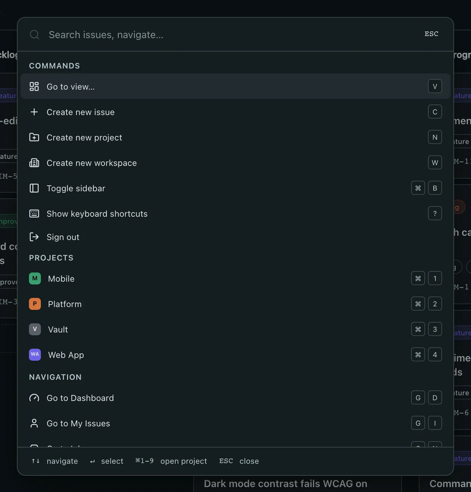
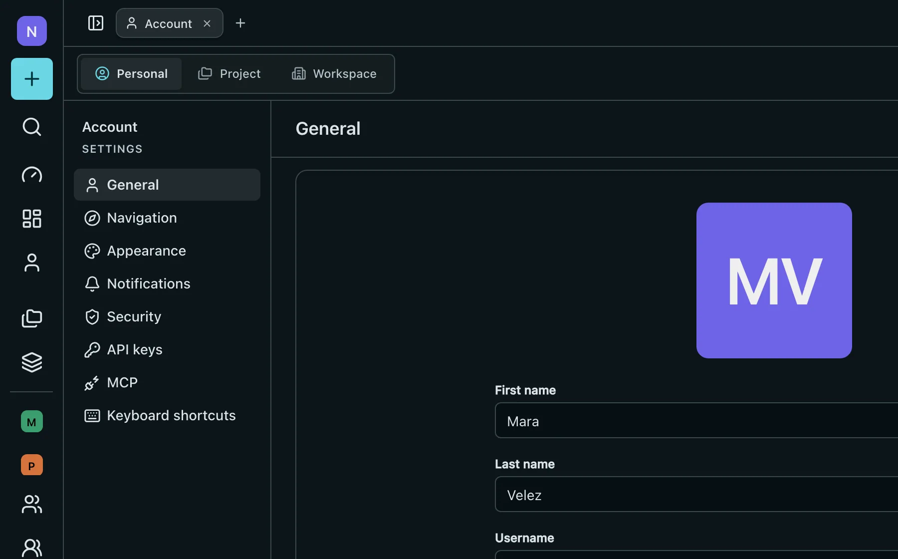

# Barynt 1.0.1

**A faster way around Barynt.** The command palette can now create projects and workspaces, reaches every main page and shows the shortcut for each of its entries. Five new shortcuts take you to the inbox, views, your account and the workspace's members and settings. Plus fixes for passkeys, the sidebar and the settings navigation.

## ✨ Highlights

- **Create from the palette** — `⌘K`, then "Create new project" or "Create new workspace". Both only show up if you may do that.
- **Every shortcut at a glance** — each entry in the palette shows the keys that do the same, including the ones you set yourself.
- **New shortcuts** — `W` creates a workspace, `G N` opens the inbox, `G V` views, `G A` your account, `G U` and `G W` the workspace's members and settings.
- **Your project stays open in the sidebar** — wherever you are in a project, its entry in the sidebar is expanded.
- **Passkeys on the current WebAuthn library** — with a fix for a security advisory. Passkeys you already have keep working.

## ⌘ The command palette

Press `⌘K` (`Ctrl K` on Windows and Linux) anywhere in a workspace.

- **New commands:** create a project, create a workspace, toggle the sidebar and sign out. A command only appears when you are allowed to use it, the same as in the sidebar.
- **More places to go:** dashboard, projects, views and your account join my issues, inbox, members, teams and settings. Members and settings now only show up for people who may open them.
- **Shortcuts on the right:** every entry shows the shortcut that does the same thing. If you changed a shortcut under Account → Keyboard shortcuts, you see your own keys. On a phone or tablet without a keyboard, no shortcuts are shown.

## ⌨️ New shortcuts

| Keys    | Does                                                 |
| ------- | ---------------------------------------------------- |
| `W`     | Create a new workspace                               |
| `G` `N` | Open the inbox                                       |
| `G` `V` | Open views                                           |
| `G` `A` | Open your account                                    |
| `G` `U` | Open the workspace's members, even from in a project |
| `G` `W` | Open the workspace settings, even from in a project  |

`G M` and `G S` keep working as before: inside a project they open that project's members and settings. All shortcuts are listed under `?` and can be changed under Account → Keyboard shortcuts.

## 🐛 Fixes

- **Settings navigation with a collapsed sidebar.** Collapsing the sidebar to its icons also shrank the navigation in the settings to icons. It now keeps its labels.
- **The current project in the sidebar.** A project only expanded when you were on one of its listed pages, and only on the first page you opened. It now expands wherever you are in it, also on an issue or after switching projects.
- **Shortcuts that started with `G`.** The second key also triggered its own shortcut: `G P` on an issue opened the priority picker as well. It now only does what the `G` shortcut says.
- **Tooltips with a collapsed sidebar.** Tooltips outside the sidebar were placed as if they sat in it.

## 🔐 Passkeys and dependencies

Passkeys now run on version 14 of the WebAuthn library. Version 9 had a security advisory: during registration it did not check firmly enough that an authenticator's certificate leads back to a trusted root. Nothing changes for you: passkeys registered before the update keep working, and signing in and adding a passkey work as before.

Next.js, the editor, the mail library and other dependencies are on their latest versions too.

<!-- changes:start -->

<!-- changes:end -->
