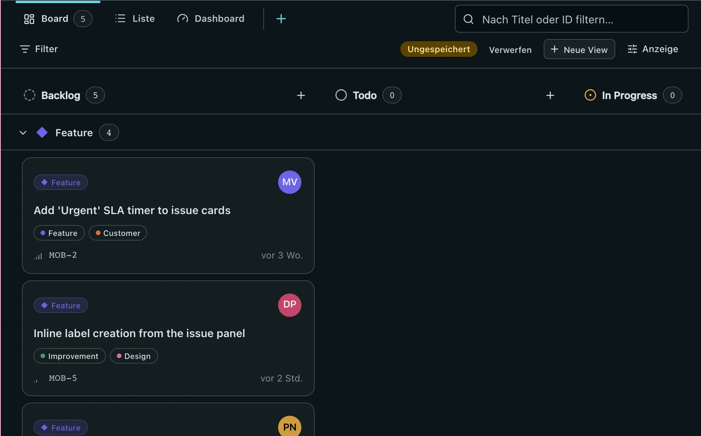
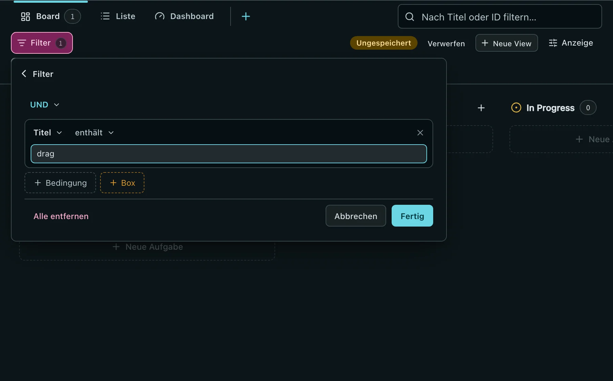

# Barynt 1.0.2

**Das Board passt sich dir an.** Spalten lassen sich in der Breite ziehen, beim Verschieben einer Karte scrollst du mit Mausrad oder Trackpad einfach weiter, und Bahnen behalten ihren Titel im Blick. Dazu drei neue Filter für Titel, Beschreibung und Kommentare, Suchen, die sich als View speichern lassen, und schnellere Rollenwechsel.

## ✨ Highlights

- **Spaltenbreite nach Wunsch** — zieh den rechten Rand eines Spaltenkopfs, um mehr vom Titel jeder Karte zu sehen.
- **Ziehen und dabei scrollen** — beim Verschieben einer Karte scrollen Mausrad und Trackpad die Spalte unter der Karte, und am Rand scrollt sie von selbst.
- **Bahnen mit festem Titel** — der Titel einer Bahn bleibt oben stehen, lange Bahnen scrollen für sich.
- **Text in Titel, Beschreibung und Kommentaren finden** — drei neue Bedingungen in den erweiterten Filtereinstellungen.
- **Suchen als View speichern** — was im Suchfeld steht, wird mit der View gespeichert.
- **Rollen sofort ändern** — eine neue Rolle steht direkt in der Liste der Mitglieder.

## 🗂️ Das Board

- **Spaltenbreite:** Fahr über einen Spaltenkopf und zieh seinen rechten Rand. Ein Doppelklick setzt die Breite zurück. Barynt merkt sich die Breiten auf deinem Gerät, und eine Spalte ist auf jedem Board gleich breit.
- **Karten verschieben:** Während du eine Karte hältst, scrollen Mausrad und Trackpad die Spalte darunter. Hältst du die Karte nah an den Rand, scrollt die Spalte von selbst, umso schneller, je näher du kommst. `Esc` legt die Karte zurück.
- **Spalten umsortieren:** Greif eine Spalte an einer beliebigen Stelle ihres Kopfs und zieh sie an ihren neuen Platz.
- **Bahnen:** Der Titel einer Bahn bleibt beim Scrollen unter den Spaltenköpfen stehen. Eine lange Bahn scrollt für sich, damit die anderen in Reichweite bleiben, und beim Scrollen beginnt immer eine Bahn sauber oben.

## 🔍 Filter und Views

- **Titel, Beschreibung, Kommentar:** In den erweiterten Filtereinstellungen findest du drei neue Felder mit der Bedingung _enthält_. So siehst du zum Beispiel alle Aufgaben, deren Titel „checkout“ enthält, oder jede Aufgabe, in deren Kommentaren „Erstattung“ vorkommt. Groß- und Kleinschreibung spielen keine Rolle.
- **Suche in Views:** Was du ins Feld **Nach Titel oder ID filtern…** eingibst, gehört jetzt zur View. Speichere es mit **Neue View**, und die View öffnet sich mit derselben Suche. **Verwerfen** stellt auch das Suchfeld wieder her.

## 👥 Mitglieder

- **Rollen ändern:** Die gewählte Rolle steht sofort in der Liste, eine kleine Ladeanzeige zeigt, dass sie gespeichert wird.
- **Übersichtliches Rollenmenü:** Das Menü zeigt die Namen der Rollen, kurz und auf einen Blick.

## ⚡ Schneller unterwegs

Benachrichtigungen und E-Mails verschickt Barynt jetzt im Hintergrund. Rollen ändern, Aufgaben zuweisen, kommentieren oder einladen ist damit sofort fertig, die Benachrichtigung folgt einen Augenblick später.

## 💅 Feinschliff

- Eine Karte, die du aufnimmst und an ihrer Stelle wieder loslässt, bleibt genau dort.
- Das **+** im Spaltenkopf bleibt beim Darüberfahren an seinem Platz.
- Lange Namen in der Benutzerkarte unten in der Seitenleiste enden sauber vor der Glocke.

<!-- github-only:start -->
## 🛠️ Für die Entwicklung

`bun run dev` lässt sich jetzt auch über eine Adresse im lokalen Netz und über die Portweiterleitung von VS Code öffnen, das Anmelden eingeschlossen.
<!-- github-only:end -->
