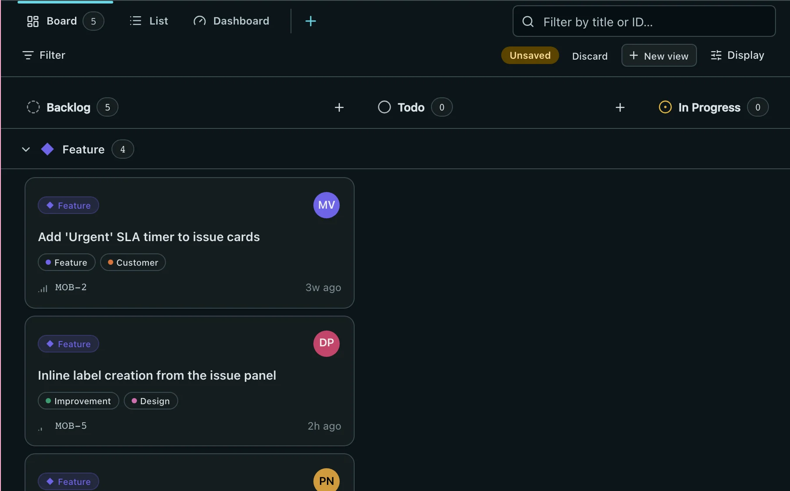
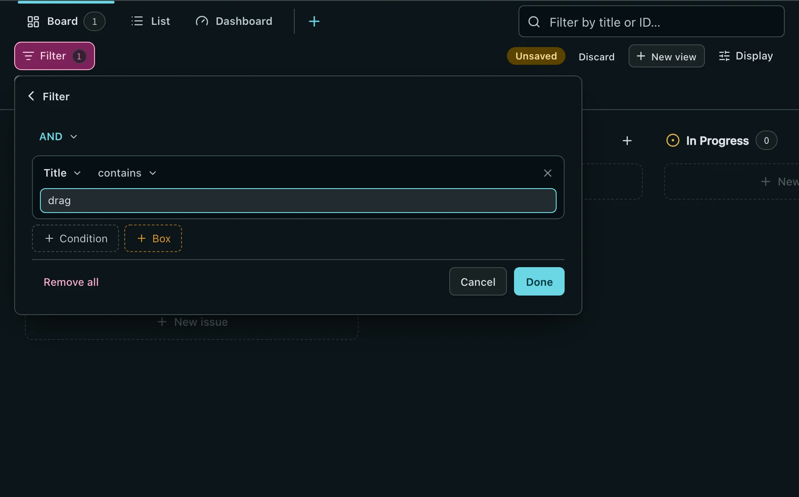

# Barynt 1.0.2

**A board that fits the way you work.** Drag columns to the width you want, keep scrolling with your mouse wheel or trackpad while you move a card, and keep every swimlane's title in view. Plus three new filters for titles, descriptions and comments, searches you can save as a view, and quicker role changes.

## ✨ Highlights

- **Column widths your way** — drag the right edge of a column header to see more of each card's title.
- **Drag and scroll at once** — while you move a card, the mouse wheel and trackpad scroll the column under it, and near the edge it scrolls by itself.
- **Swimlanes with a fixed title** — a lane's title stays at the top, and long lanes scroll on their own.
- **Find text in titles, descriptions and comments** — three new conditions in the advanced filter settings.
- **Save a search as a view** — what's in the search box is saved with the view.
- **Roles change at once** — a new role shows in the member list right away.

## 🗂️ The board

- **Column width:** Hover over a column header and drag its right edge. Double-click to go back to the default. Barynt remembers the widths on your device, and a column has the same width on every board.
- **Moving cards:** While you hold a card, the mouse wheel and trackpad scroll the column beneath it. Hold the card near an edge and the column scrolls by itself, faster the closer you get. `Esc` puts the card back.
- **Reordering columns:** Grab a column anywhere on its header and drag it to its new place.
- **Swimlanes:** A lane's title stays just below the column headers while you scroll. A long lane scrolls on its own so the others stay within reach, and scrolling always lands on the start of a lane.

## 🔍 Filters and views

- **Title, description, comment:** The advanced filter settings have three new fields with the condition _contains_. Show every issue whose title contains "checkout", for example, or every issue where a comment mentions "refund". Upper and lower case don't matter.
- **Search in views:** What you type into **Filter by title or ID** is now part of the view. Save it with **New view**, and the view opens with the same search. **Discard** brings the search box back too.

## 👥 Members

- **Changing roles:** The role you pick shows in the list right away, with a small spinner while it's saved.
- **A clearer role menu:** The menu lists the roles by name, short and easy to scan.

## ⚡ Faster

Barynt now sends notifications and emails in the background. Changing a role, assigning an issue, commenting or inviting someone is done at once, and the notification follows a moment later.

## 💅 Polish

- A card you pick up and release on its own spot stays exactly there.
- The **+** in a column header stays in place when you hover over it.
- Long names in the user card at the bottom of the sidebar end neatly before the bell.

<!-- github-only:start -->
## 🛠️ For development

`bun run dev` now also opens over an address on your local network and through VS Code's port forwarding, signing in included.
<!-- github-only:end -->
